# Documentação Técnica e Guia de Utilização do MemoryDB

Esta pasta reúne a documentação técnica, os requisitos e o manual de utilização do MemoryDB.

MemoryDB é um servidor chave-valor em memória, implementado em Go, com comunicação TCP e mensagens Protocol Buffers (Protobuf).

O projeto separa armazenamento, execução de comandos, protocolo interno, serialização, transporte, controle de idempotência e drivers. Essa organização permite evoluir os componentes sem acoplar diretamente o núcleo do banco às tecnologias de comunicação.

## 1. Estado atual

A implementação atual contempla:

- Servidor TCP com conexões persistentes.
- Comandos PING, SET, GET e DELETE.
- Armazenamento de chaves `string` e valores `[]byte`.
- Compartilhamento dos dados entre conexões da mesma instância.
- Proteção concorrente do armazenamento.
- Storage implementado como módulo Go independente, reutilizado pelo servidor como biblioteca no mesmo processo.
- Injeção da implementação concreta de Storage no Engine por meio de uma interface definida pelo próprio Engine.
- Framing TCP independente da serialização.
- Contrato externo definido em Protobuf.
- Driver cliente Go.
- Operações do driver com suporte a `context.Context`.
- Tratamento de erros de comunicação e resultados indeterminados.
- Atendimento concorrente de múltiplos clientes.
- Limite configurável de conexões TCP simultâneas.
- Timeouts configuráveis de leitura e escrita no transporte TCP.
- Encerramento gracioso do servidor, com fechamento forçado de conexões quando o prazo de shutdown expira.
- Workspace Go composto por módulos independentes.
- Idempotência server-side para operações SET e DELETE.
- Identificação de operações por `OperationID` de 16 bytes.
- Deduplicação de solicitações repetidas e reprodução de respostas.
- Detecção de reutilização de `OperationID` com parâmetros diferentes.
- Controle de retenção e capacidade dos registros de idempotência.

### Limitações importantes

A implementação atual não possui:

- Persistência em disco.
- Expiração funcional por TTL.
- Autenticação ou autorização.
- TLS.
- Isolamento de dados por tenant.
- Multiplexação de solicitações na mesma conexão.
- Pool de conexões integrado ao driver Go.
- Reconexão ou retry automático.
- Persistência dos registros de idempotência.
- Replicação ou compartilhamento de registros de idempotência entre instâncias.
- Garantia de execução exatamente uma vez.
- Observabilidade integrada por métricas, tracing ou monitoramento.
- Limite global configurável de memória do processo.

O campo `ttl_ms` existe no contrato Protobuf, mas valores positivos são rejeitados como funcionalidade não suportada.

A idempotência está implementada somente para SET e DELETE. PING e GET não utilizam `OperationID`.

Os registros de idempotência são mantidos em memória, na instância do servidor. A retenção padrão dos registros concluídos é de 24 horas, com capacidade padrão de 100.000 registros. Operações em andamento também ocupam capacidade e não expiram enquanto estiverem em execução.

A recuperação de uma resposta indeterminada depende de uma nova tentativa com o mesmo `OperationID` e os mesmos parâmetros, enquanto o registro correspondente ainda estiver retido na mesma instância. Reinicializações ou encerramentos do processo eliminam os registros.

O `request_id` permite correlacionar solicitações e respostas, mas não substitui o `OperationID`. O primeiro identifica uma tentativa de comunicação; o segundo identifica uma operação lógica de mutação.

O limite de conexões controla quantas conexões TCP simultâneas o servidor admite. Ele não limita diretamente a quantidade de operações por conexão e não representa suporte a multiplexação.

Os timeouts de leitura e escrita são aplicados às respectivas operações de I/O TCP. Eles não representam um prazo global de execução de uma operação de negócio.

O encerramento forçado fecha as conexões TCP ativas para interromper operações de I/O pendentes. Isso não constitui um mecanismo genérico de cancelamento de qualquer operação interna do servidor.

O limite de tamanho do frame TCP e a capacidade do registro de idempotência não representam um limite global de consumo de memória do processo.

**Segurança:** o servidor não deve ser exposto a redes não confiáveis sem mecanismos adicionais de proteção.

## 2. Documentação disponível

| Documento | Conteúdo | Público principal |
|---|---|---|
| [Arquitetura técnica](./tecnica/ARQUITETURA.md) | Camadas, módulos, fluxos, contratos, dependências e decisões arquiteturais observáveis | Desenvolvedores e arquitetos |
| [Catálogo de componentes](./tecnica/COMPONENTES.md) | Responsabilidades, interfaces, arquivos, dependências e comportamentos dos componentes | Desenvolvedores e mantenedores |
| [Requisitos e critérios de aceite](./requisitos/REQUISITOS.md) | Requisitos funcionais e não funcionais, cenários, casos de borda, lacunas e rastreabilidade | Desenvolvimento e QA |
| [Manual do usuário](./usuario/MANUAL.md) | Pré-requisitos, inicialização, demonstração, comandos, driver Go, erros e limitações | Desenvolvedores consumidores, QA e suporte |
| [Guia do driver Go](../drivers/go/README.md) | Instalação e integração do driver Go em aplicações independentes | Desenvolvedores consumidores |
| [Guia de testes](./tecnica/TESTES.md) | Execução dos testes, verificações técnicas e análise de cobertura | Desenvolvimento e QA |

## 3. Por onde começar

### Quero executar o MemoryDB

Consulte o [Manual do usuário](./usuario/MANUAL.md).

O documento apresenta os pré-requisitos, a inicialização do servidor, a configuração do endereço TCP e a execução do cliente de demonstração.

### Quero executar os testes e validar o projeto

Consulte o [Guia de testes](./tecnica/TESTES.md).

### Quero integrar uma aplicação Go

Consulte o [Manual do usuário](./usuario/MANUAL.md) e o [Guia do driver Go](../drivers/go/README.md).

Eles apresentam a conexão, os comandos disponíveis, as operações com contexto, o tratamento de erros, a utilização de `OperationID` e as limitações do driver.

### Quero entender a arquitetura

Comece por [Arquitetura técnica](./tecnica/ARQUITETURA.md).

Em seguida, consulte o [Catálogo de componentes](./tecnica/COMPONENTES.md) para localizar responsabilidades e arquivos específicos.

### Quero verificar o que está implementado

Consulte [Requisitos e critérios de aceite](./requisitos/REQUISITOS.md).

O documento diferencia comportamentos implementados, critérios de aceite, limitações e funcionalidades pendentes.

### Quero conhecer as próximas evoluções

Consulte o [Roadmap de implementação](../memorydb-roadmap.md).

O roadmap apresenta objetivos, princípios, etapas e evoluções planejadas. Itens descritos como planejados não devem ser interpretados como funcionalidades disponíveis.

## 4. Estrutura modular do projeto

O MemoryDB utiliza um workspace Go definido em `go.work`, composto por sete módulos independentes.

| Módulo | Caminho | Responsabilidade |
|---|---|---|
| Servidor | `server/` | Executável, Engine, interfaces internas, codec, handler TCP e integração com idempotência |
| Storage | `storage/go/` | Biblioteca independente de armazenamento em memória, com operações concorrentes de leitura, escrita e remoção |
| Transporte TCP | `transport/tcp/go/` | Conexão TCP e framing, independentes da serialização |
| Protocolo gerado | `protocol/generated/go/` | Tipos Go gerados a partir do schema Protobuf |
| Driver Go | `drivers/go/` | Biblioteca cliente para comunicação com o servidor |
| API de demonstração | `api/` | Aplicação executável que utiliza o driver Go |
| Shared | `shared/` | Configurações e definições compartilhadas entre módulos |

O contrato Protobuf está definido em:

`protocol/proto/memorydb/v1/memorydb.proto`

Cada módulo possui seu próprio `go.mod`. O workspace permite desenvolver e testar os módulos locais de forma integrada, sem exigir que estejam publicados como dependências externas.

O módulo Storage possui identidade e ciclo de dependências próprios, mas sua utilização pelo servidor ocorre como biblioteca Go. A implementação concreta é criada na inicialização do servidor e injetada no Engine por meio de uma interface definida no módulo Server.

Portanto, Engine e Storage executam no mesmo processo, compartilham o espaço de endereçamento e o heap da aplicação e se comunicam por chamadas locais de métodos. Não existe comunicação RPC, IPC ou tráfego de rede entre esses componentes.

O workspace facilita o desenvolvimento conjunto, mas aplicações independentes devem utilizar versões publicadas ou referências locais configuradas para os módulos dos quais dependem.

## 5. Fluxo geral de comunicação

O fluxo de uma operação segue esta sequência:

```mermaid
flowchart LR
    Client["Aplicação cliente"]
    Driver["Driver Go"]
    TCP["Transporte TCP"]
    Codec["Codec Protobuf"]
    Handler["Handler TCP"]
    Executor["Executor de idempotência"]
    Engine["Engine"]
    Storage["Storage (módulo independente)"]

    Client --> Driver
    Driver --> TCP
    TCP --> Codec
    Codec --> Handler
    Handler --> Executor
    Executor --> Engine
    Engine --> Storage

    Storage --> Engine
    Engine --> Executor
    Executor --> Handler
    Handler --> Codec
    Codec --> TCP
    TCP --> Driver
    Driver --> Client
```

O transporte delimita as mensagens em frames TCP. O codec converte entre o modelo interno e o contrato Protobuf. O handler interpreta as solicitações e encaminha as operações ao executor de idempotência.

Para SET e DELETE, o executor verifica o `OperationID`, compara a impressão digital da operação e controla a execução ou a reprodução de resultados. Quando necessário, encaminha a operação ao Engine, que executa o comando sobre o Storage por meio da interface de armazenamento.

PING e GET são encaminhados diretamente ao Engine, sem utilização do mecanismo de idempotência.

O Engine depende da abstração de Storage, não da implementação concreta. Na inicialização, o executável do servidor instancia o módulo `storage/go` e injeta essa implementação no Engine.

Essa separação modular não introduz uma fronteira de processo: a interação entre Engine e Storage permanece local, por chamadas de métodos Go.

A resposta percorre o caminho inverso até o cliente.

## 6. Idempotência

O MemoryDB implementa idempotência server-side para SET e DELETE.

Cada operação lógica de mutação deve possuir um `OperationID` de 16 bytes, fornecido pelo cliente. O driver Go disponibiliza a função `NewOperationID()` para gerar identificadores.

O comportamento implementado contempla:

- Reutilização do mesmo identificador com os mesmos parâmetros: reprodução do resultado original.
- Reutilização do mesmo identificador com parâmetros diferentes: rejeição por conflito.
- Solicitações concorrentes com o mesmo identificador e parâmetros: aguardam a operação original e recebem resultado equivalente.
- Atualização do `request_id` da resposta reproduzida para corresponder à tentativa atual.
- Retenção de registros concluídos por 24 horas.
- Capacidade padrão de 100.000 registros por instância.
- Contabilização de operações em andamento na capacidade disponível.
- Rejeição de novos identificadores quando a capacidade está esgotada, sem reservar o identificador rejeitado.

A impressão digital da operação é calculada com SHA-256 e considera o tipo de operação, a chave e os parâmetros relevantes. Para SET, também considera o valor e o TTL. O próprio `OperationID` não integra a impressão digital.

O mecanismo não remove antecipadamente registros válidos para liberar espaço. Quando a capacidade é atingida, novas operações são rejeitadas até que haja capacidade disponível.

A idempotência não oferece garantia de execução exatamente uma vez. Os registros são voláteis, não são replicados e não sobrevivem à reinicialização do servidor.

Para detalhes sobre o contrato, os estados, os erros e o comportamento em situações de falha, consulte a [Arquitetura técnica](./tecnica/ARQUITETURA.md) e o [Manual do usuário](./usuario/MANUAL.md).

## 7. Validação técnica

O projeto possui testes automatizados para os principais componentes e fluxos:

- Engine e validação de comandos.
- Storage e concorrência.
- Codificação e decodificação Protobuf.
- Framing TCP, fragmentação, limites e escritas parciais.
- Atendimento de múltiplas conexões.
- Compartilhamento de armazenamento entre clientes.
- Executor de idempotência.
- Deduplicação, conflitos e operações concorrentes com o mesmo identificador.
- Retenção e capacidade dos registros de idempotência.
- Operações e concorrência no driver Go.
- Cancelamento, deadlines e falhas de comunicação.
- Resultados indeterminados.
- Limites de conexões simultâneas.
- Timeouts de leitura e escrita.
- Encerramento gracioso e forçado do servidor.

Os procedimentos reproduzíveis de validação estão centralizados nos scripts de `scripts/test/` e documentados no [Guia de testes](./tecnica/TESTES.md). Os resultados históricos abaixo registram execuções realizadas naquele momento e não substituem uma nova execução após alterações no código.

### Evidências registradas

Na validação registrada em 15/11/2026, foram executados testes com detector de condições de corrida e análise estática nos módulos do workspace:

| Módulo | Testes com `-race` | `go vet` |
|---|---|---|
| `protocol/generated/go` | Aprovado — sem testes próprios | Aprovado |
| `transport/tcp/go` | Aprovado | Aprovado |
| `drivers/go` | Aprovado | Aprovado |
| `server` | Aprovado | Aprovado |
| `api` | Aprovado — sem testes próprios | Aprovado |

Em validações posteriores, foram registrados testes, análise estática e compilação dos módulos. Também foram executadas rodadas repetidas com o detector de condições de corrida, incluindo `go test -race -count=20 ./...` nos módulos aplicáveis.

Também foi registrada validação manual ponta a ponta envolvendo conexão TCP, PING, SET, GET e DELETE.

**Atenção:** os resultados acima representam execuções registradas nas respectivas datas. A validação completa de 15/11 não substitui uma nova execução integral de todos os módulos após alterações posteriores. Consulte os testes e o histórico de validação antes de afirmar que uma revisão específica está integralmente validada.

## 8. Documentação e manutenção

A documentação deve acompanhar o comportamento efetivamente implementado.

Ao alterar o projeto:

1. Atualize a arquitetura quando houver mudança de camadas, dependências, fluxos ou contratos.
2. Atualize o catálogo de componentes quando responsabilidades, interfaces ou arquivos forem alterados.
3. Atualize os requisitos quando houver mudança de comportamento ou de critérios de aceite.
4. Atualize o manual quando houver mudança de instalação, configuração, utilização ou tratamento de erros.
5. Atualize o roadmap quando prioridades, etapas ou objetivos planejados forem modificados.
6. Registre evidências de testes com os comandos efetivamente executados e seus resultados.

Distinga sempre:

- **Implementado:** comportamento presente no código e verificável.
- **Validado:** comportamento coberto por uma execução de teste ou verificação identificável.
- **Planejado:** evolução prevista, ainda não implementada.
- **Lacuna:** capacidade ausente ou comportamento ainda não definido.

Não apresente uma funcionalidade planejada como disponível nem uma execução antiga como evidência de validação do estado atual do código.

## 9. Referências do projeto

- [Repositório MemoryDB](https://github.com/pescador95/memorydb)
- [Documentação oficial do Go](https://go.dev/doc/)
- [Gerenciamento de módulos Go](https://go.dev/doc/modules/managing-dependencies)
- [Protocol Buffers](https://protobuf.dev/)

---

**MemoryDB**

Servidor chave-valor em memória com comunicação TCP e protocolo Protocol Buffers.