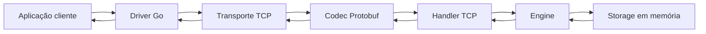

# Documentação do MemoryDB

Esta pasta reúne a documentação técnica, os requisitos e o manual de utilização do MemoryDB.

MemoryDB é um servidor chave-valor em memória, implementado em Go, com comunicação TCP e mensagens Protocol Buffers (Protobuf).

O projeto separa armazenamento, execução de comandos, protocolo interno, serialização, transporte e drivers. Essa organização permite evoluir os componentes sem acoplar diretamente o núcleo do banco às tecnologias de comunicação.

## 1. Estado atual

A implementação atual contempla:

- Servidor TCP com conexões persistentes.
- Comandos PING, SET, GET e DELETE.
- Armazenamento de chaves `string` e valores `[]byte`.
- Compartilhamento dos dados entre conexões da mesma instância.
- Proteção concorrente do armazenamento.
- Framing TCP independente da serialização.
- Contrato externo definido em Protobuf.
- Driver cliente Go.
- Operações do driver com suporte a `context.Context`.
- Tratamento de erros de comunicação e resultados indeterminados.
- Atendimento concorrente de múltiplos clientes.
- Workspace Go composto por módulos independentes.

### Limitações importantes

A implementação atual não possui:

- Persistência em disco.
- Expiração funcional por TTL.
- Autenticação ou autorização.
- TLS.
- Isolamento de dados por tenant.
- Multiplexação de solicitações na mesma conexão.
- Pool de conexões integrado ao driver Go.
- Reconexão ou retry automático.
- Deduplicação ou idempotência server-side.
- Recuperação posterior de resultados de operações indeterminadas.

O campo `ttl_ms` existe no contrato Protobuf, mas valores positivos são rejeitados como funcionalidade não suportada.

O `request_id` permite correlacionar solicitações e respostas, mas não é uma chave de idempotência. Quando a comunicação é interrompida durante uma operação, o cliente pode não conseguir determinar se o servidor executou o comando.

**Segurança:** o servidor não deve ser exposto a redes não confiáveis sem mecanismos adicionais de proteção.

## 2. Documentação disponível

| Documento | Conteúdo | Público principal |
|---|---|---|
| [Arquitetura técnica](./tecnica/ARQUITETURA.md) | Camadas, módulos, fluxos, contratos, dependências e decisões arquiteturais observáveis. | Desenvolvedores e arquitetos |
| [Catálogo de componentes](./tecnica/COMPONENTES.md) | Responsabilidades, interfaces, arquivos, dependências e comportamentos dos componentes. | Desenvolvedores e mantenedores |
| [Requisitos e critérios de aceite](./requisitos/REQUISITOS.md) | Requisitos funcionais e não funcionais, cenários, casos de borda, lacunas e rastreabilidade. | Desenvolvimento e QA |
| [Manual do usuário](./usuario/MANUAL.md) | Pré-requisitos, inicialização, demonstração, comandos, driver Go, erros e limitações. | Desenvolvedores consumidores, QA e suporte |
| [Guia do driver Go](../drivers/go/README.md) | Instalação e integração do driver Go em aplicações independentes. | Desenvolvedores consumidores |

## 3. Por onde começar

### Quero executar o MemoryDB

Consulte o [Manual do usuário](./usuario/MANUAL.md).

O documento apresenta os pré-requisitos, a inicialização do servidor, a configuração do endereço TCP e a execução do cliente de demonstração.

### Quero integrar uma aplicação Go

Consulte o [Manual do usuário](./usuario/MANUAL.md) e o [Guia do driver Go](../drivers/go/README.md).

Eles apresentam a conexão, os comandos disponíveis, as operações com contexto, o tratamento de erros e as limitações do driver.

### Quero entender a arquitetura

Comece por [Arquitetura técnica](./tecnica/ARQUITETURA.md).

Em seguida, consulte o [Catálogo de componentes](./tecnica/COMPONENTES.md) para localizar responsabilidades e arquivos específicos.

### Quero verificar o que está implementado

Consulte [Requisitos e critérios de aceite](./requisitos/REQUISITOS.md).

O documento diferencia comportamentos implementados, critérios de aceite, limitações e funcionalidades pendentes.

### Quero conhecer as próximas evoluções

Consulte o [Roadmap de implementação](../memorydb-roadmap.md).

O roadmap apresenta objetivos, princípios, etapas e evoluções planejadas. Itens descritos como planejados não devem ser interpretados como funcionalidades disponíveis.

## 4. Estrutura modular do projeto

O MemoryDB utiliza um workspace Go definido em `go.work`, composto por módulos independentes.

| Módulo | Caminho | Responsabilidade |
|---|---|---|
| Servidor | `server/` | Executável, engine, storage, codec e integração com TCP. |
| Transporte TCP | `transport/tcp/go/` | Conexão TCP e framing, independentes da serialização. |
| Protocolo gerado | `protocol/generated/go/` | Tipos Go gerados a partir do schema Protobuf. |
| Driver Go | `drivers/go/` | Biblioteca cliente para comunicação com o servidor. |
| API de demonstração | `api/` | Aplicação executável que utiliza o driver Go. |

O contrato Protobuf está definido em:

`protocol/proto/memorydb/v1/memorydb.proto`

Cada módulo possui seu próprio `go.mod`. O workspace permite desenvolver e testar os módulos locais de forma integrada, sem exigir que estejam publicados como dependências externas.

## 5. Fluxo geral de comunicação

O fluxo de uma operação segue esta sequência:



O transporte delimita as mensagens em frames TCP. O codec converte entre o modelo interno e o contrato Protobuf. O handler encaminha as solicitações ao engine, que executa os comandos sobre o storage.

A resposta percorre o caminho inverso até o cliente.

## 6. Validação técnica

O projeto possui testes automatizados para os principais componentes e fluxos:

- Engine e validação de comandos.
- Storage e concorrência.
- Codificação e decodificação Protobuf.
- Framing TCP, fragmentação, limites e escritas parciais.
- Atendimento de múltiplas conexões.
- Compartilhamento de armazenamento entre clientes.
- Operações e concorrência no driver Go.
- Cancelamento, deadlines e falhas de comunicação.
- Resultados indeterminados.
- Encerramento do servidor.

### Evidências registradas

Na validação registrada em 15/11/2026, foram executados testes com detector de condições de corrida e análise estática nos módulos do workspace:

| Módulo | Testes com `-race` | `go vet` |
|---|---|---|
| `protocol/generated/go` | Aprovado — sem testes próprios | Aprovado |
| `transport/tcp/go` | Aprovado | Aprovado |
| `drivers/go` | Aprovado | Aprovado |
| `server` | Aprovado | Aprovado |
| `api` | Aprovado — sem testes próprios | Aprovado |

Em validação posterior do driver Go, foram executados com sucesso:

```bash
go test -v -count=1 ./drivers/go
go test -race -count=1 ./drivers/go
go test -race -count=20 ./drivers/go
go vet ./drivers/go
```

Também foi registrada uma validação manual ponta a ponta envolvendo conexão TCP, PING, SET, GET e DELETE.

**Atenção:** os resultados acima representam execuções registradas nas respectivas datas. A validação completa de 15/11 não substitui uma nova execução integral de todos os módulos após alterações posteriores. Consulte os testes e o histórico de validação antes de afirmar que uma revisão específica está integralmente validada.

## 7. Documentação e manutenção

A documentação deve acompanhar o comportamento efetivamente implementado.

Ao alterar o projeto:

1. Atualize a arquitetura quando houver mudança de camadas, dependências, fluxos ou contratos.
2. Atualize o catálogo de componentes quando responsabilidades, interfaces ou arquivos forem alterados.
3. Atualize os requisitos quando houver mudança de comportamento ou de critérios de aceite.
4. Atualize o manual quando houver mudança de instalação, configuração, utilização ou tratamento de erros.
5. Atualize o roadmap quando prioridades, etapas ou objetivos planejados forem modificados.
6. Registre evidências de testes com os comandos efetivamente executados e seus resultados.

Distinga sempre:

- **Implementado:** comportamento presente no código e verificável.
- **Validado:** comportamento coberto por uma execução de teste ou verificação identificável.
- **Planejado:** evolução prevista, ainda não implementada.
- **Lacuna:** capacidade ausente ou comportamento ainda não definido.

Não apresente uma funcionalidade planejada como disponível nem uma execução antiga como evidência de validação do estado atual do código.

## 8. Referências do projeto

- [Repositório MemoryDB](https://github.com/pescador95/memorydb)
- [Documentação oficial do Go](https://go.dev/doc/)
- [Gerenciamento de módulos Go](https://go.dev/doc/modules/managing-dependencies)
- [Protocol Buffers](https://protobuf.dev/)

---

**MemoryDB**

Servidor chave-valor em memória com comunicação TCP e protocolo Protocol Buffers.