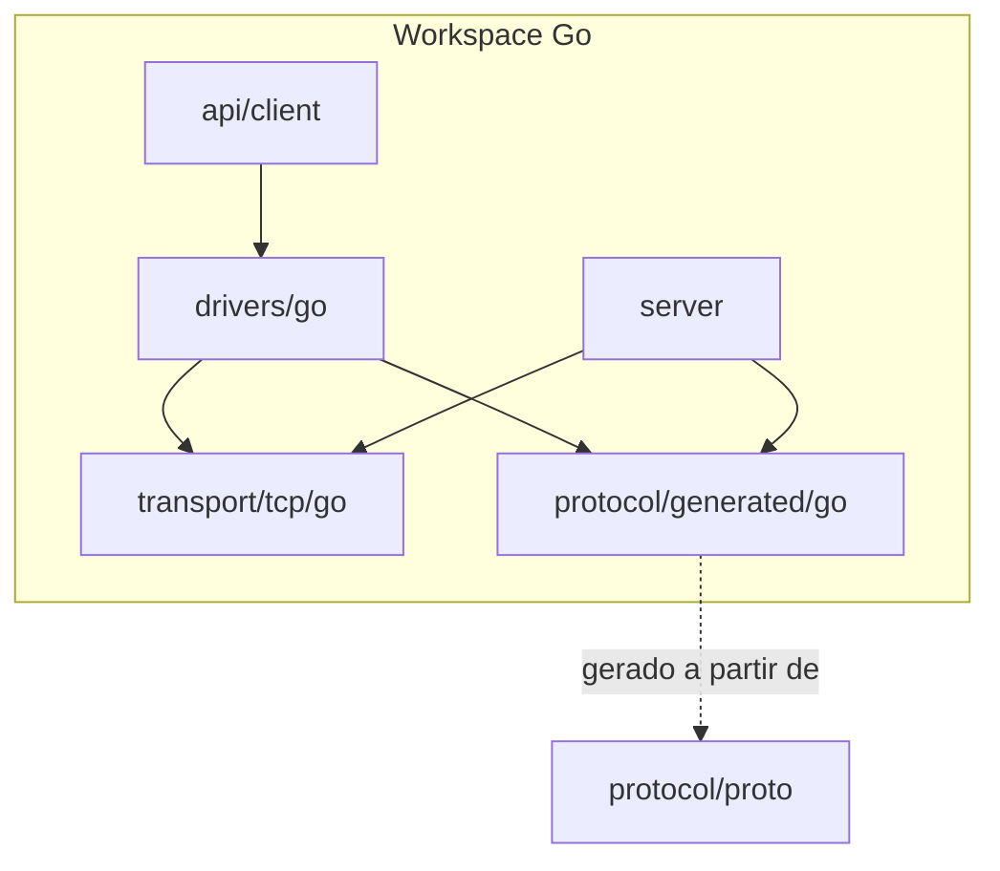
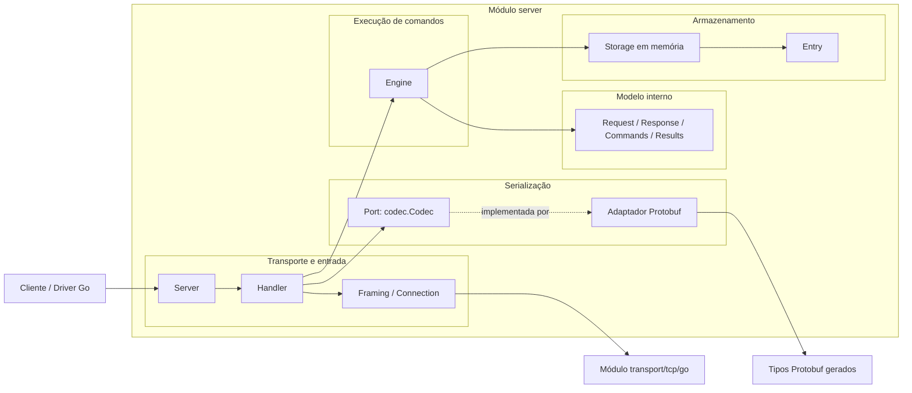
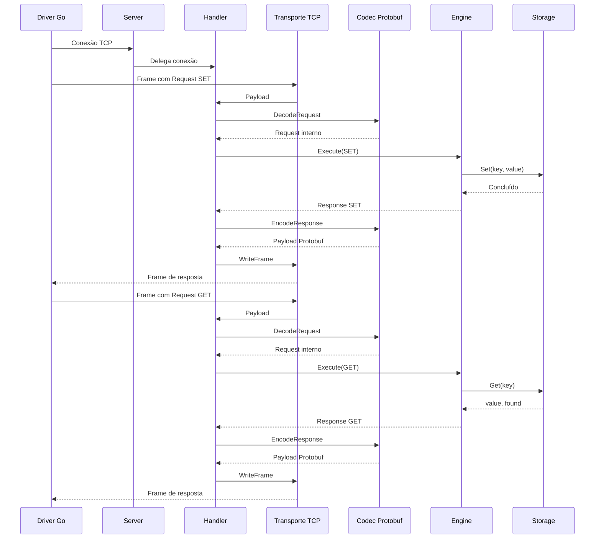
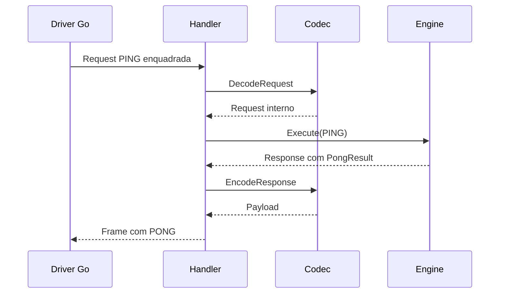
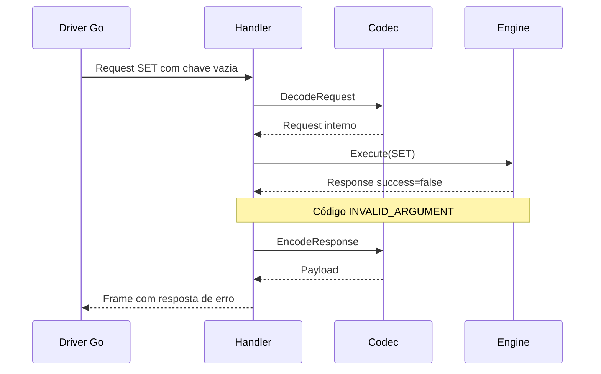
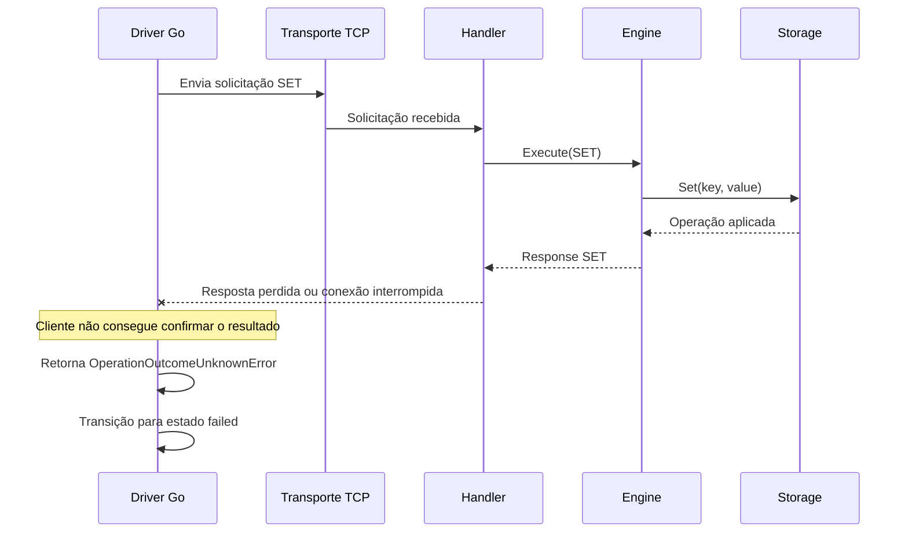
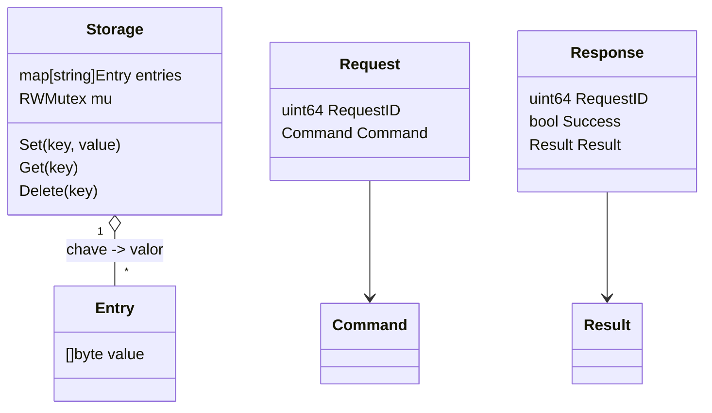

# Arquitetura do MemoryDB

## Visão geral

MemoryDB é um banco de dados chave-valor em memória, implementado inicialmente em Go. O servidor aceita os comandos PING, SET, GET e DELETE por TCP, utilizando Protocol Buffers como formato de serialização das mensagens.

A implementação separa armazenamento, execução de comandos, modelo interno, serialização e transporte. O transporte TCP reutilizável e o driver Go são módulos independentes do servidor. Essa organização permite evoluir os componentes sem acoplar diretamente o mecanismo de execução a um protocolo de rede específico.

O servidor compartilha uma única instância de armazenamento entre as conexões ativas. Os dados existem somente na memória do processo e são perdidos quando o servidor é encerrado.

O projeto utiliza múltiplos módulos Go coordenados por um workspace (`go.work`).

## Estrutura modular

| Módulo | Caminho | Responsabilidade |
|---|---|---|
| Servidor | `server/` | Composição do servidor, engine, storage, codec e integração com TCP |
| Transporte TCP | `transport/tcp/go/` | Framing e abstração de conexão TCP reutilizável |
| Driver Go | `drivers/go/` | Cliente Go para comunicação com o servidor |
| Protocolo gerado | `protocol/generated/go/` | Tipos Go gerados a partir do schema Protobuf |
| Contrato Protobuf | `protocol/proto/` | Definição independente da linguagem do protocolo externo |
| API de demonstração | `api/` | Executável de demonstração que utiliza o driver Go |

O arquivo `go.work`, na raiz do repositório, coordena os módulos durante o desenvolvimento local. Cada módulo possui seu próprio `go.mod`.

## Diagrama de módulos e responsabilidades



O servidor e o driver compartilham os módulos de transporte TCP e de tipos Protobuf gerados. O driver não depende dos pacotes internos do servidor.

O contrato Protobuf é mantido separado do código gerado. O arquivo `.proto` é a fonte do contrato; os arquivos gerados não devem ser editados manualmente.

## Diagrama de camadas e dependências internas do servidor

As camadas abaixo representam responsabilidades observadas na implementação. Não significam que o projeto adote formalmente uma estrutura Clean Architecture ou DDD.



O `codec.Codec` desacopla a implementação do handler da serialização concreta. O adaptador Protobuf implementa esse contrato.

O transporte TCP genérico é responsável pelo enquadramento das mensagens e pela comunicação com `net.Conn`. Ele não conhece Protocol Buffers nem o modelo interno do servidor.

O `Engine` depende diretamente de `*storage.Storage`, em vez de consumir uma interface que abstraia o armazenamento.

## Componentes principais

### Modelo interno — `server/internal/protocol`

Representa solicitações e respostas sem depender dos tipos gerados pelo Protobuf ou de detalhes do transporte.

`Request` contém o identificador da solicitação e um comando. `Response` contém o identificador, o estado de sucesso e o resultado.

Os comandos internos representam PING, SET, GET e DELETE. Os resultados representam PONG, SET, GET, DELETE e erro.

Arquivo principal: `server/internal/protocol/message.go`.

### Engine — `server/internal/engine`

O `Engine` executa os comandos e aplica as validações da aplicação.

Comportamentos implementados:

- Requisição nula, comando ausente/desconhecido ou comando tipado nulo resulta em `INVALID_REQUEST`.
- Chave vazia em SET, GET ou DELETE resulta em `INVALID_ARGUMENT`.
- SET com `TTLMillis > 0` resulta em `UNSUPPORTED_FEATURE`.
- SET com TTL igual a zero grava o valor sem expiração.
- GET distingue chave inexistente de chave existente com valor vazio.
- DELETE retorna sucesso e informa se a chave foi removida.
- O `RequestID` da solicitação é preservado na resposta.

O `Engine` depende diretamente de `*storage.Storage`, sem uma interface intermediária para abstrair o armazenamento.

Arquivos principais:

- `server/internal/engine/engine.go`
- `server/internal/engine/command.go`

### Storage — `server/internal/storage`

Armazena os dados em um mapa em memória.

Características:

- Chaves do tipo `string`.
- Valores do tipo `[]byte`.
- Proteção de acesso concorrente com `sync.RWMutex`.
- Cópia dos bytes recebidos em SET.
- Cópia dos bytes retornados em GET.
- Remoção de chaves por DELETE.

A estrutura `Entry` guarda o valor. Não existe atualmente campo de expiração ou mecanismo de persistência.

Arquivos principais:

- `server/internal/storage/storage.go`
- `server/internal/storage/entry.go`

### Codec — `server/internal/codec`

Define a interface `codec.Codec`, responsável por converter o modelo interno em bytes e reconstruir o modelo a partir deles.

Operações:

- `EncodeRequest`
- `DecodeRequest`
- `EncodeResponse`
- `DecodeResponse`

O contrato não exige uma serialização específica. Isso permite implementar outros codecs sem alterar o modelo interno ou a interface consumidora.

Arquivo principal: `server/internal/codec/codec.go`.

### Adaptador Protobuf — `server/internal/codec/protobuf`

Implementa `codec.Codec` utilizando Protocol Buffers.

Converte os tipos internos de solicitação e resposta para os tipos gerados a partir do schema Protobuf e realiza a conversão inversa.

O adaptador depende do módulo `protocol/generated/go`, mas o modelo interno não depende dos tipos gerados.

Arquivo principal: `server/internal/codec/protobuf/codec.go`.

### Transporte TCP reutilizável — `transport/tcp/go`

Módulo independente que implementa o framing e encapsula a conexão TCP.

O protocolo de framing utiliza:

- Prefixo de 4 bytes.
- Tamanho representado por `uint32`.
- Ordem de bytes Big Endian.
- Payload entre 1 byte e 1 MiB.
- Leitura completa com tratamento de fragmentação.
- Escrita com tratamento de escritas parciais.

A abstração `Connection` encapsula `net.Conn` e oferece operações de leitura, escrita e fechamento.

Características de concorrência e ciclo de vida:

- Leituras e escritas podem ocorrer simultaneamente.
- Operações concorrentes do mesmo tipo são serializadas por mutexes independentes.
- `Close` fecha diretamente a conexão subjacente, permitindo interromper operações de I/O bloqueadas.
- Os métodos públicos validam o receiver nulo.
- A criação da conexão também rejeita interfaces nulas e conexões tipadas como nil.
- A escrita completa trata escritas parciais e valida contagens inválidas retornadas pelo writer.

Arquivos principais:

- `transport/tcp/go/framing.go`
- `transport/tcp/go/connection.go`

Esse módulo não depende de Protobuf, do engine ou do servidor.

As funções públicas `ReadFrame` e `WriteFrame` também validam a presença de seus respectivos leitores e escritores, retornando erro quando recebem interfaces nulas.

### Handler — `server/internal/transport/tcp`

O `Handler` conecta o transporte TCP ao codec e ao engine.

Para cada conexão:

1. Cria a abstração de conexão TCP.
2. Lê um frame.
3. Decodifica a solicitação.
4. Executa o comando no engine.
5. Codifica a resposta.
6. Escreve o frame de resposta.
7. Repete o processo enquanto a conexão permanecer aberta.

Erros de leitura do frame, decodificação da solicitação, codificação da resposta ou escrita do frame encerram o processamento da conexão. Uma falha de decodificação não gera uma resposta estruturada de aplicação.

Arquivo principal: `server/internal/transport/tcp/handler.go`.

### Server — `server/internal/transport/tcp`

O `Server` controla o listener TCP e o ciclo de vida das conexões.

`Serve()` aceita conexões e inicia uma goroutine para processar cada cliente. O servidor mantém um controle das conexões ativas.

`Shutdown(context.Context)` fecha o listener e aguarda as conexões ativas terminarem ou o contexto ser cancelado.

O servidor não fecha diretamente as conexões ativas durante o shutdown. Assim, uma conexão que não termina pode manter a operação aguardando até o cancelamento do contexto.

Arquivo principal: `server/internal/transport/tcp/server.go`.

### Driver Go — `drivers/go`

Biblioteca cliente que permite aplicações Go se conectarem ao MemoryDB sem depender dos pacotes internos do servidor.

Responsabilidades:

- Estabelecer conexão TCP.
- Enviar e receber frames.
- Codificar e decodificar mensagens Protobuf.
- Correlacionar solicitações e respostas por `request_id`.
- Expor operações PING, SET, GET e DELETE.
- Converter respostas de erro do servidor em erros Go.
- Serializar operações concorrentes do cliente no modelo sequencial de requisição/resposta.
- Permitir controle do estabelecimento da conexão e das operações por meio de `context.Context`.
- Gerenciar o ciclo de vida da conexão e impedir a reutilização de clientes encerrados ou que sofreram falhas de comunicação.
- Diferenciar erros de aplicação de situações em que o resultado de uma operação não pode ser confirmado.

A API oferece os métodos convencionais `Dial`, `Ping`, `Set`, `Get` e `Delete`, além de suas variantes com contexto: `DialContext`, `PingContext`, `SetContext`, `GetContext` e `DeleteContext`.

#### Conexão e contexto

`DialContext` utiliza o contexto para controlar o estabelecimento da conexão. O contexto utilizado nessa etapa não fica associado às operações posteriores do cliente.

Nas operações, o contexto pode atuar em dois momentos distintos:

1. **Antes do início da operação:** o cliente pode estar aguardando acesso à conexão por meio do mecanismo de serialização. Se o contexto for cancelado durante essa espera, a operação não começa, o erro de contexto é retornado diretamente e o cliente permanece disponível.
2. **Durante a comunicação:** se o contexto for cancelado enquanto a operação está em andamento, o cliente interrompe o I/O fechando a conexão. Como a solicitação pode já ter sido enviada e executada pelo servidor, não é possível garantir se o comando foi aplicado.

O segundo cenário invalida a conexão e leva o cliente ao estado `failed`.

#### Estados internos do cliente

O cliente possui três estados internos:

- `open`: conexão disponível para operações.
- `closed`: cliente encerrado explicitamente por `Close`.
- `failed`: conexão invalidada após falha de comunicação ou protocolo.

A transição para `failed` impede que operações futuras utilizem uma conexão cujo estado de comunicação não é mais confiável.

#### Serialização das operações

As operações são serializadas por um mecanismo de exclusão mútua baseado em canal (`operationGate`), permitindo que apenas uma solicitação utilize a conexão por vez.

Esse comportamento corresponde ao protocolo atual, que não implementa multiplexação de solicitações e respostas na mesma conexão.

A serialização evita que respostas de operações concorrentes sejam associadas incorretamente às requisições.

O `request_id` identifica e correlaciona uma solicitação com sua resposta. No estado atual, ele é sequencial e local à conexão. Não constitui uma chave de idempotência nem oferece deduplicação de comandos.

#### Tratamento de erros e resultado indeterminado

O driver diferencia erros de aplicação retornados pelo servidor de falhas de transporte ou protocolo.

Erros estruturados de aplicação são representados por `ServerError`. Eles indicam que o servidor retornou uma resposta de erro reconhecível e não invalidam automaticamente a conexão.

Falhas de comunicação podem impedir que o cliente saiba se uma operação foi executada. Exemplos:

- Escrita parcial ou falha de escrita depois que parte da solicitação foi transmitida.
- Cancelamento ou deadline durante a comunicação.
- Conexão interrompida depois do envio da solicitação e antes da confirmação.
- Resposta perdida ou incompleta.
- Resposta Protobuf inválida.
- Divergência entre o `request_id` enviado e o recebido.
- Tipo de resposta incompatível com a operação solicitada.

Para esses casos, o driver disponibiliza `OperationOutcomeUnknownError`.

Esse erro contém:

- `RequestID`: identificador da solicitação cujo resultado não pôde ser confirmado.
- `Cause`: causa subjacente da falha de comunicação ou interrupção.

O tipo implementa `Unwrap()`, preservando a possibilidade de inspeção da causa por meio de `errors.Is` e `errors.As`.

A semântica de `OperationOutcomeUnknownError` é importante: **o cliente não está afirmando que a operação falhou, mas que não possui confirmação suficiente para determinar se ela foi executada**.

Por exemplo, uma operação SET pode ter sido aplicada pelo servidor antes de a resposta se perder. Nesse cenário, retornar apenas um erro de transporte poderia induzir a aplicação cliente a interpretar incorretamente que a operação não ocorreu.

O driver não realiza retry automático. A aplicação cliente não deve repetir cegamente uma operação com resultado indeterminado sem considerar sua semântica e os efeitos de uma possível execução anterior.

A implementação atual ainda não oferece:

- Identificador de operação estável entre tentativas.
- Deduplicação de operações no servidor.
- Armazenamento de resultados anteriores para recuperação de respostas.
- Garantia de execução idempotente baseada em contrato distribuído.
- Reconexão automática ou recuperação transparente de operações interrompidas.

Essas capacidades fazem parte de uma evolução arquitetural futura.

#### Arquivos principais

- `drivers/go/client.go`
- `drivers/go/client_test.go`

### API de demonstração — `api/client`

Executável que utiliza o driver Go para demonstrar a comunicação com o servidor.

O executável não implementa outro protocolo de comunicação nem acessa diretamente os componentes internos do servidor. Ele utiliza a API pública do driver.

Arquivo principal: `api/client/main.go`.

### Executável do servidor — `server/cmd/memorydb`

Ponto de composição da aplicação.

Responsabilidades:

- Obter o endereço de escuta da variável `MEMORYDB_ADDR`.
- Utilizar `:6380` como endereço padrão.
- Instanciar o codec Protobuf.
- Instanciar o engine.
- Criar o handler TCP.
- Criar e iniciar o servidor.
- Tratar sinais de encerramento.
- Solicitar shutdown gracioso com timeout de 10 segundos.

Arquivo principal: `server/cmd/memorydb/main.go`.

## Fluxos principais

### SET seguido de GET



### PING



### Erro de argumento



### Resultado indeterminado no driver

O fluxo abaixo representa uma situação em que o servidor executa a operação, mas a resposta não chega ao cliente.



Nesse cenário, o erro representa incerteza sobre o resultado da operação, e não uma confirmação de que o servidor deixou de executá-la.

## Contrato de comunicação

O MemoryDB não expõe uma API HTTP na implementação atual. Os comandos são transmitidos por TCP utilizando frames com prefixo de tamanho e payload Protobuf.

O contrato externo está definido em `protocol/proto/memorydb/v1/memorydb.proto`.

| Comando | Campos da requisição | Resposta de sucesso | Erros de aplicação |
|---|---|---|---|
| PING | `request_id`; comando `ping` | `success=true`, resultado `pong` | `INVALID_REQUEST` |
| SET | `request_id`; `key`; `value`; `ttl_ms` | `success=true`, resultado `set` | `INVALID_ARGUMENT`, `UNSUPPORTED_FEATURE`, `INVALID_REQUEST` |
| GET | `request_id`; `key` | `success=true`, resultado `get`, com `found` e `value` | `INVALID_ARGUMENT`, `INVALID_REQUEST` |
| DELETE | `request_id`; `key` | `success=true`, resultado `delete`, com `deleted` | `INVALID_ARGUMENT`, `INVALID_REQUEST` |

O envelope de resposta contém `request_id`, `success` e um resultado selecionado por `oneof`.

Quando há erro de aplicação, o resultado contém `ErrorResult`, com código e mensagem.

Erros de framing ou de decodificação Protobuf encerram o processamento da conexão. Não há garantia de resposta estruturada de aplicação nesses casos.

O `request_id` é utilizado para correlação entre solicitação e resposta. Ele não representa uma chave de idempotência e não permite deduplicar solicitações repetidas.

## Modelo de dados



O armazenamento é um mapa em memória. As chaves são strings e os valores são bytes.

Não há persistência, identificação de tenant, timestamp ou expiração de entradas na implementação atual.

`Request` e `Response` são modelos de mensagens internas, não entidades de domínio com identidade ou ciclo de vida.

## Dependências e configurações

| Dependência ou configuração | Utilização |
|---|---|
| Go 1.27.0 | Versão declarada nos módulos |
| `google.golang.org/protobuf` v1.36.12 | Serialização e desserialização Protobuf |
| Biblioteca padrão `net` | Comunicação TCP |
| Biblioteca padrão `encoding/binary` | Codificação do tamanho dos frames |
| Biblioteca padrão `io` | Leitura e escrita completas |
| Biblioteca padrão `sync` | Sincronização de acesso |
| Biblioteca padrão `context` | Controle do shutdown e cancelamento de operações no driver Go |
| `MEMORYDB_ADDR` | Endereço do listener do servidor |
| `:6380` | Endereço padrão do servidor |
| `go.work` | Coordenação dos módulos durante o desenvolvimento |

## Decisões arquiteturais atuais

1. **Separação entre transporte e serialização:** o módulo TCP não depende de Protobuf. O framing pode ser reutilizado por outros protocolos.
2. **Modelo interno independente:** o engine e os componentes internos não utilizam diretamente os tipos Protobuf gerados.
3. **Driver independente do servidor:** aplicações Go consomem a biblioteca cliente sem importar pacotes internos do servidor.
4. **Módulos independentes:** cada componente possui seu próprio `go.mod`; o workspace facilita o desenvolvimento conjunto.
5. **Execução sequencial por conexão:** o driver serializa as operações e o handler processa uma solicitação por vez em cada conexão.
6. **Armazenamento compartilhado:** todas as conexões atendidas pela mesma instância do servidor utilizam o mesmo storage.
7. **Falha conservadora do cliente:** quando a comunicação deixa de oferecer condições para confirmar o resultado de uma operação, o driver invalida a conexão em vez de reutilizá-la em estado incerto.
8. **Separação entre erro de aplicação e incerteza de execução:** respostas estruturadas de erro são diferentes de falhas de comunicação que impedem confirmar o resultado da operação.
9. **Ausência de retry automático:** o driver não repete operações automaticamente quando o resultado é indeterminado, evitando introduzir duplicidade de execução sem um contrato de idempotência.

## Lacunas arquiteturais identificadas

1. **Port de armazenamento ausente:** o engine depende de `*storage.Storage`, não de uma interface.
2. **Domínio não formalizado:** o modelo interno representa comandos, resultados e mensagens, mas não há uma camada explícita de entidades ou value objects.
3. **Observabilidade incompleta:** o erro retornado por `Handler.Handle` é descartado pela goroutine do servidor; não há registro estruturado de falhas de conexão nesse ponto.
4. **Shutdown sem encerramento forçado:** o servidor fecha o listener e aguarda as conexões, mas não mantém uma estratégia de fechamento forçado das conexões ativas.
5. **Limites operacionais incompletos:** não há política configurável de timeout de leitura e escrita no servidor ou limite de conexões concorrentes. O driver Go permite utilizar contextos com cancelamento e deadline nas operações, mas o cancelamento durante I/O invalida a conexão.
6. **Multiplexação ausente:** o protocolo possui `request_id`, mas o driver atual trabalha com uma solicitação por vez em cada conexão. O identificador permite correlacionar requisições e respostas, mas não implementa processamento concorrente de solicitações na mesma conexão.
7. **Persistência ausente:** os dados são perdidos quando o processo termina.
8. **TTL não implementado:** o campo existe no contrato, mas valores positivos são rejeitados.
9. **Contrato de idempotência ausente:** não há identificador de operação estável entre tentativas, deduplicação no servidor ou recuperação de resultados anteriores. O `request_id` atual não oferece essas garantias.
10. **Recuperação de resultado indeterminado ausente:** depois de uma falha de comunicação, o cliente não consegue consultar o resultado de uma operação anterior por meio de um identificador estável.
11. **Política de retenção de deduplicação inexistente:** como ainda não há deduplicação, não existe política de expiração ou retenção de registros de operações processadas.

## Testes e validação

O projeto possui testes para:

- Armazenamento e concorrência.
- Execução de comandos no engine.
- Conversão Protobuf.
- Framing TCP e tratamento de fragmentação.
- Comunicação e ciclo de vida das conexões.
- Driver Go e tratamento de erros.
- Integração entre cliente e servidor.

### Validação do transporte TCP

A camada TCP possui testes para:

- Serialização e desserialização de frames.
- Ordem Big Endian do prefixo de tamanho.
- Leitura de payloads fragmentados.
- Cabeçalhos e payloads incompletos.
- Tamanho zero e payload acima do limite.
- Escritas parciais e writer sem progresso.
- Validação de reader e writer nulos.
- Conexões nulas e receivers nulos.
- Interrupção de leitura e escrita bloqueadas por `Close`.
- Escritas e leituras concorrentes.
- Operações simultâneas de leitura e escrita.

Os testes com `net.Pipe()` permitem verificar cenários determinísticos de comunicação, mas não substituem testes adicionais utilizando sockets TCP reais.

### Validação do driver Go

A cobertura do driver inclui:

- Operações convencionais e operações com contexto.
- Validação de conexão e contexto nulos.
- Serialização de operações concorrentes.
- Correlação de requisições e respostas por `request_id`.
- Respostas Protobuf inválidas e incompatíveis.
- Erros estruturados retornados pelo servidor.
- Fechamento do cliente e falhas de comunicação.
- Cancelamento antes do início da operação.
- Cancelamento durante a espera pelo acesso à conexão.
- Interrupção de I/O por cancelamento ou deadline.
- Escrita parcial com resultado indeterminado.
- Operação SET executada pelo servidor cuja resposta não chega ao cliente.
- Cancelamento durante a leitura da resposta final.

Foram executados e aprovados:

```bash
go test -v -count=1 ./drivers/go
go test -race -count=1 ./drivers/go
go test -race -count=20 ./drivers/go
go vet ./drivers/go
```

A execução repetida com o detector de condições de corrida passou nos testes do driver. O `go vet` também terminou sem apontamentos.

Esses resultados documentam a validação recente do módulo `drivers/go`; não representam uma nova execução consolidada de todos os módulos do workspace.

### Validação ponta a ponta

Foi executada uma validação manual em 15/11/2026, utilizando o servidor real e a aplicação `api/client`.

O fluxo validado foi:

1. Conexão TCP e PING.
2. SET de uma chave.
3. GET e conferência do valor.
4. DELETE da chave.
5. Novo GET, confirmando que a chave não foi encontrada.

Resultado: ciclo completo executado com sucesso.

### Limites da validação

Os testes atuais demonstram o comportamento dos componentes nos cenários exercitados, mas não representam garantias de disponibilidade, durabilidade ou recuperação distribuída.

Ainda são necessárias validações específicas para:

- Falhas de processo e reinicialização do servidor.
- Limites de conexões e comportamento sob carga.
- Timeouts operacionais no lado servidor.
- Testes de rede com sockets TCP reais e falhas controladas.
- Contrato de idempotência e deduplicação.
- Recuperação de operações após perda de resposta.
- Persistência e recuperação de dados, quando implementadas.