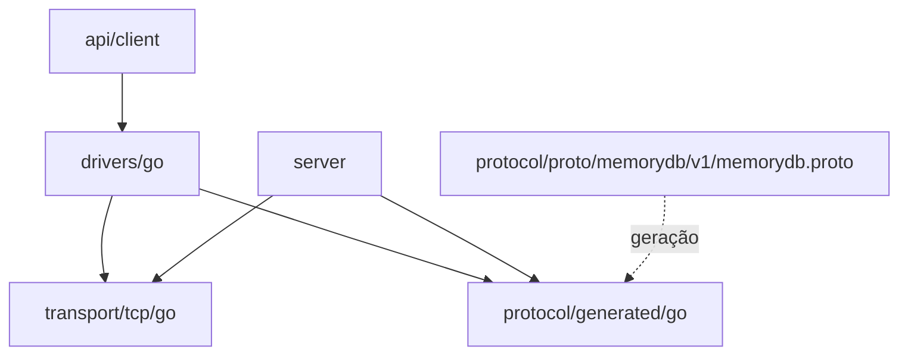
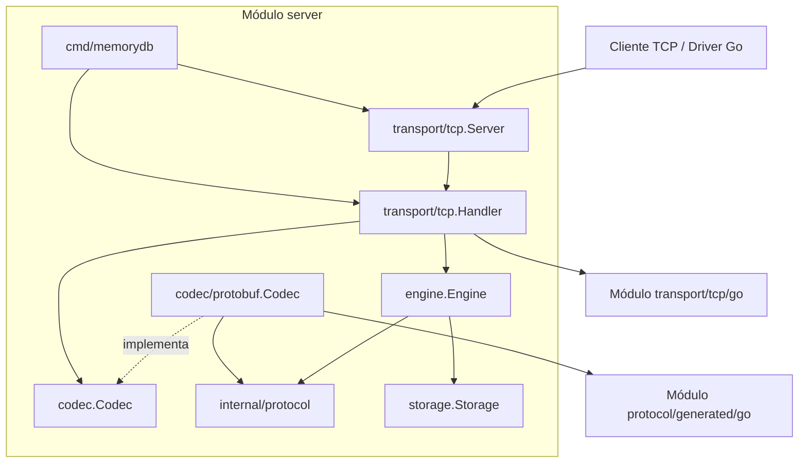
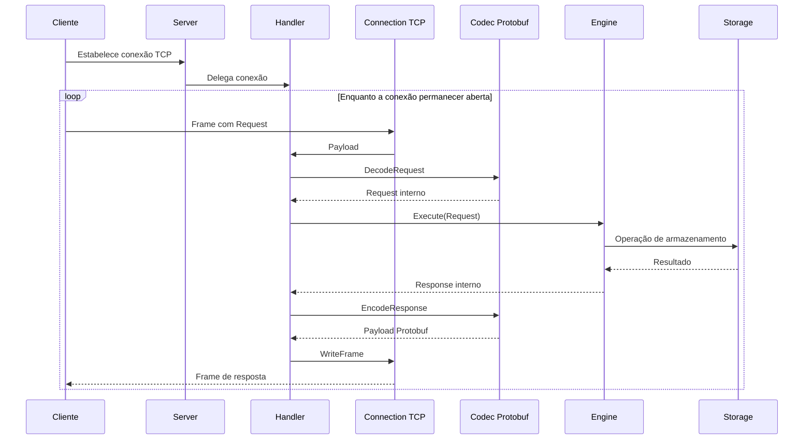
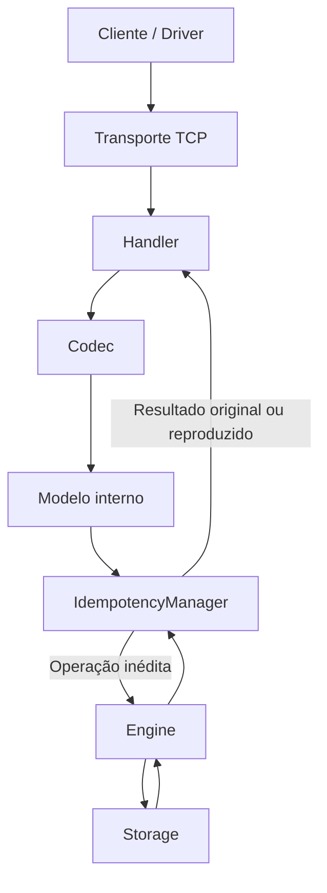

# Arquitetura do MemoryDB

## 1. Visão geral

MemoryDB é um banco de dados chave-valor em memória, implementado em Go. Na implementação atual, o servidor recebe comandos `PING`, `SET`, `GET` e `DELETE` por TCP, utilizando Protocol Buffers para serializar as mensagens.

A arquitetura separa responsabilidades de:

- composição e ciclo de vida do servidor;
- transporte TCP e framing;
- codificação e decodificação de mensagens;
- representação interna das solicitações e respostas;
- execução dos comandos;
- armazenamento em memória;
- comunicação de aplicações clientes por meio de um driver Go.

O servidor mantém uma instância de `Engine`, que possui uma instância própria de `Storage`. Essa mesma instância de `Engine` é utilizada pelo handler das conexões aceitas pelo servidor. Portanto, as conexões atendidas pelo mesmo processo compartilham o mesmo armazenamento.

Os dados permanecem exclusivamente na memória do processo. Não há persistência, recuperação após reinicialização ou replicação.

A arquitetura descrita neste documento representa a implementação existente, não uma arquitetura-alvo.

## 2. Organização dos módulos Go

O repositório utiliza múltiplos módulos Go coordenados pelo workspace da raiz (`go.work`).

| Módulo | Diretório | Responsabilidade |
|---|---|---|
| Servidor | `server/` | Composição do servidor, execução de comandos, armazenamento, codec e integração TCP |
| Transporte TCP | `transport/tcp/go/` | Framing e abstração reutilizável de conexão TCP |
| Driver Go | `drivers/go/` | Biblioteca cliente para aplicações Go |
| Protocolo gerado | `protocol/generated/go/` | Tipos Go gerados a partir do schema Protobuf |
| API de demonstração | `api/` | Executável que demonstra o uso do driver |
| Contrato Protobuf | `protocol/proto/` | Schema independente da linguagem |

Cada módulo mantém seu próprio `go.mod`. O `go.work` inclui os módulos locais utilizados no desenvolvimento e define substituições para dependências internas do projeto.

O driver e o servidor compartilham os módulos de transporte TCP e de tipos Protobuf gerados. O driver não importa os pacotes internos do servidor.

### 2.1 Dependências entre módulos

O schema `.proto` é a fonte do contrato externo. Os arquivos Go gerados devem ser tratados como artefatos de geração, não como arquivos para edição manual.

A presença de opções de geração para outras linguagens no schema não significa que existam drivers ou implementações dessas linguagens no estado atual.

## 3. Arquitetura interna do servidor

As responsabilidades internas do servidor estão distribuídas entre os seguintes pacotes:

| Pacote | Responsabilidade |
|---|---|
| `server/cmd/memorydb` | Inicialização, composição das dependências, configuração e encerramento |
| `server/internal/transport/tcp` | Aceitação de conexões e processamento de solicitações |
| `server/internal/codec` | Contrato de codificação e decodificação |
| `server/internal/codec/protobuf` | Adaptação entre o modelo interno e os tipos Protobuf |
| `server/internal/protocol` | Modelo interno de solicitações, comandos, respostas e resultados |
| `server/internal/engine` | Validação e execução dos comandos |
| `server/internal/storage` | Armazenamento chave-valor em memória |

### 3.1 Diagrama de responsabilidades

O diagrama representa responsabilidades e dependências. Não significa que o projeto implemente formalmente Clean Architecture, Hexagonal Architecture ou DDD.

### 3.2 Direção das dependências

O modelo interno (`server/internal/protocol`) não depende dos tipos gerados pelo Protobuf nem do transporte TCP.

O pacote `codec.Codec` define um contrato utilizado pelo handler. A implementação concreta atual é `codec/protobuf.Codec`.

O transporte TCP reutilizável não conhece Protobuf, engine, storage ou os pacotes internos do servidor.

O `Engine`, por outro lado, depende diretamente de `*storage.Storage`. Não existe atualmente uma interface de armazenamento que permita substituir o backend sem alterar o engine.

## 4. Transporte e contrato de comunicação

A comunicação externa utiliza TCP. Cada mensagem é transmitida em um frame composto por:

- cabeçalho de 4 bytes;
- tamanho do payload representado por `uint32`;
- ordem de bytes Big Endian;
- payload com tamanho mínimo de 1 byte;
- tamanho máximo de 1 MiB.

O payload contém uma mensagem serializada em Protocol Buffers.

O framing é implementado em `transport/tcp/go/framing.go`. A abstração `Connection`, em `transport/tcp/go/connection.go`, encapsula `net.Conn` e fornece operações de leitura, escrita e fechamento.

### 4.1 Concorrência no transporte

A `Connection` utiliza mutexes independentes para leitura e escrita:

- operações de leitura concorrentes são serializadas;
- operações de escrita concorrentes são serializadas;
- uma leitura e uma escrita podem ocorrer simultaneamente;
- `Close` fecha diretamente a conexão subjacente e pode interromper operações de I/O bloqueadas.

A implementação de framing utiliza leitura completa e escrita em loop para tratar fragmentação e escritas parciais.

O transporte TCP é independente do protocolo de serialização. Isso permite reutilizá-lo sem acoplar o framing ao Protobuf.

### 4.2 Contrato Protobuf

O contrato externo está definido em `protocol/proto/memorydb/v1/memorydb.proto`.

O envelope `Request` contém:

- `request_id`;
- um comando selecionado por `oneof`.

O envelope `Response` contém:

- `request_id`;
- `success`;
- um resultado selecionado por `oneof`.

Os comandos definidos são `PING`, `SET`, `GET` e `DELETE`. O schema também define os respectivos resultados e uma estrutura de erro com código e mensagem.

O campo `request_id` permite correlacionar uma resposta com sua solicitação. Ele não é um identificador de operação estável entre tentativas e não oferece idempotência ou deduplicação.

### 4.3 Semântica dos comandos

| Comando | Comportamento implementado |
|---|---|
| `PING` | Retorna uma resposta `PONG` |
| `SET` | Armazena o valor associado à chave |
| `GET` | Retorna o valor e informa se a chave existe |
| `DELETE` | Remove a chave e informa se ela existia |

As validações de aplicação são realizadas pelo engine:

- solicitação nula, comando ausente, desconhecido ou tipado nulo: `INVALID_REQUEST`;
- chave vazia em `SET`, `GET` ou `DELETE`: `INVALID_ARGUMENT`;
- `SET` com `ttl_ms` maior que zero: `UNSUPPORTED_FEATURE`;
- `SET` com TTL igual a zero: gravação sem expiração.

O `GET` diferencia uma chave inexistente de uma chave existente cujo valor é vazio. O `DELETE` informa se a chave foi efetivamente removida.

Erros de framing ou de decodificação Protobuf encerram o processamento da conexão. Eles não são convertidos necessariamente em uma resposta estruturada de aplicação.

## 5. Fluxo de processamento de uma solicitação

O handler processa solicitações sequencialmente em cada conexão.

O handler executa as seguintes etapas:

1. cria uma abstração `Connection` para a conexão recebida;
2. lê um frame;
3. decodifica a solicitação;
4. executa o comando no engine;
5. codifica a resposta;
6. escreve o frame de resposta;
7. repete o processamento enquanto a conexão permanecer aberta.

Uma falha de leitura, decodificação, codificação ou escrita encerra o processamento daquela conexão.

O handler retorna o erro ao servidor. Atualmente, a goroutine criada por `Server.Serve()` descarta esse retorno, sem registro estruturado da falha.

## 6. Armazenamento e ciclo de vida dos dados

O pacote `server/internal/storage` mantém os dados em um mapa indexado por chave (`string`), com valores em `[]byte`.

O acesso concorrente é protegido por `sync.RWMutex`.

O storage:

- copia os bytes recebidos em `Set`;
- copia os bytes retornados em `Get`;
- informa se uma chave existe;
- remove entradas por `Delete`.

A estrutura `Entry` guarda o valor. Não há campo de expiração.

A instância de `Storage` é criada internamente por `engine.New()`. Não existe atualmente um construtor do engine que receba uma implementação externa de storage.

O servidor cria uma instância de engine durante sua composição e utiliza esse engine para processar as conexões. Assim, as conexões de um mesmo processo compartilham os dados.

### 6.1 Limites do armazenamento atual

- Os dados são voláteis e existem apenas na memória do processo.
- O encerramento ou reinício do processo elimina os dados.
- Não há persistência em disco.
- Não há replicação.
- Não há compartilhamento de dados entre processos ou instâncias.
- TTL positivo não é implementado.

## 7. Driver Go e modelo de comunicação

O módulo `drivers/go` fornece uma biblioteca para aplicações Go se comunicarem com o servidor.

O driver depende do transporte TCP reutilizável e dos tipos Protobuf gerados. Não depende dos pacotes internos do servidor.

A API inclui:

- `Dial` e `DialContext`;
- `New`;
- `Close`;
- `Ping` e `PingContext`;
- `Set` e `SetContext`;
- `Get` e `GetContext`;
- `Delete` e `DeleteContext`.

As operações são serializadas por conexão por meio de `operationGate`. O driver permite chamadas concorrentes, mas apenas uma operação utiliza a conexão por vez.

Esse comportamento é necessário porque o protocolo atual trabalha com uma solicitação e sua resposta por vez na mesma conexão. Não existe multiplexação.

### 7.1 Identificação e correlação

O driver gera um `request_id` sequencial e local à instância do cliente/conexão. O servidor preserva esse identificador na resposta.

O identificador não é persistido, não é estável entre reconexões e não permite reconhecer uma repetição da mesma operação.

Portanto:

- `request_id` não é `operation_id`;
- `request_id` não é uma chave de idempotência;
- não existe deduplicação server-side;
- não existe recuperação de resposta anterior por identificador.

### 7.2 Estados do cliente

O driver mantém três estados internos:

| Estado | Significado |
|---|---|
| `open` | Cliente disponível para operações |
| `closed` | Cliente encerrado explicitamente |
| `failed` | Conexão invalidada após falha de comunicação ou protocolo |

O cliente não deve ser reutilizado após entrar em `closed` ou `failed`.

### 7.3 Contextos e cancelamento

`DialContext` utiliza o contexto apenas para controlar o estabelecimento da conexão. Esse contexto não fica associado às operações posteriores.

Cada operação pode receber seu próprio contexto.

O driver distingue:

- cancelamento enquanto aguarda acesso à conexão: a operação não começou, o erro de contexto é retornado e a conexão permanece disponível;
- cancelamento durante I/O: a conexão é fechada para interromper a comunicação e o resultado pode ser indeterminado.

O fechamento explícito do cliente também pode interromper uma operação de rede em andamento.

### 7.4 Resultado indeterminado

O driver disponibiliza `OperationOutcomeUnknownError` para representar uma operação cuja execução não pode ser confirmada.

O erro contém `RequestID` e `Cause`, além de implementar `Unwrap()` para preservar a inspeção da causa original.

O resultado pode ser indeterminado quando, por exemplo:

- parte da solicitação foi transmitida antes de uma falha de escrita;
- a solicitação foi enviada e a resposta não chegou;
- o contexto foi cancelado durante a comunicação;
- a conexão foi interrompida;
- a resposta recebida não pôde ser decodificada ou validada.

Esse erro não significa que o servidor deixou de executar a operação. Significa que o cliente não possui confirmação suficiente para determinar o resultado.

O driver não realiza retry automático. Repetir cegamente uma operação após resultado indeterminado pode produzir efeitos duplicados.

### 7.5 Erros de aplicação

Quando o servidor retorna uma resposta estruturada de erro válida, o driver a representa por `ServerError`.

Esse cenário é diferente de uma falha de comunicação: o cliente recebeu uma resposta de aplicação reconhecível e não invalida automaticamente a conexão.

## 8. Inicialização e encerramento do servidor

O executável está em `server/cmd/memorydb/main.go`.

A configuração de endereço utiliza:

| Configuração | Comportamento |
|---|---|
| `MEMORYDB_ADDR` | Endereço TCP utilizado pelo listener |
| Valor padrão | `:6380` |

O ponto de entrada:

1. cria o listener TCP;
2. instancia o codec Protobuf;
3. instancia o engine;
4. cria o handler;
5. cria o servidor;
6. inicia `Server.Serve()` em uma goroutine;
7. trata `SIGINT` e `SIGTERM`;
8. solicita encerramento com timeout de 10 segundos.

### 8.1 Semântica do shutdown

`Server.Shutdown(ctx)` marca o servidor como encerrando, fecha o listener e aguarda a conclusão das conexões ativas.

O método não fecha diretamente as conexões ativas.

Se uma conexão não terminar, o método pode retornar o erro do contexto quando o prazo expirar, enquanto a conexão permanece aberta. Não há atualmente uma etapa de encerramento forçado das conexões ativas.

O encerramento gracioso, portanto, depende de as conexões terminarem por conta própria dentro do prazo.

## 9. Limites arquiteturais atuais

| Área | Estado atual |
|---|---|
| Persistência | Não implementada |
| Replicação | Não implementada |
| Distribuição entre instâncias | Não implementada |
| Autenticação e autorização | Não implementadas |
| TLS | Não implementado |
| TTL | Campo no protocolo; funcionalidade não implementada |
| Idempotência | Não implementada |
| Deduplicação server-side | Não implementada |
| Retry automático | Não implementado |
| Multiplexação | Não implementada |
| Timeouts de I/O configuráveis no servidor | Não identificados na implementação atual |
| Observabilidade estruturada por conexão | Não implementada no fluxo atual |
| Shutdown forçado de conexões | Não implementado |

### 9.1. Contrato aprovado de idempotência

**Estado: especificado e aprovado em 22/11/2026; ainda não implementado.**

A evolução de idempotência introduzirá um identificador de operação (`OperationID`) independente do identificador de requisição (`RequestID`).

A responsabilidade será evitar a execução repetida de uma mesma operação lógica quando o cliente precisar repetir uma tentativa após um resultado indeterminado.

#### Identificadores

| Identificador | Responsabilidade | Ciclo de vida |
|---|---|---|
| `RequestID` | Correlacionar uma requisição com sua resposta | Novo para cada tentativa |
| `OperationID` | Identificar uma operação lógica entre tentativas | Reutilizado nas tentativas da mesma operação |

O `OperationID` terá 128 bits e será representado no contrato Protobuf por um campo `bytes`, validado para exatamente 16 bytes.

O identificador será obrigatório para `SET` e `DELETE`. `PING` e `GET` não estarão abrangidos pelo contrato inicial de idempotência.

A obrigatoriedade do campo implica atualização coordenada dos drivers e do servidor. Clientes antigos que não enviarem o identificador não poderão executar as operações mutáveis após a ativação dessa validação.

#### Escopo e retenção

Os registros de idempotência terão:

- escopo global dentro de uma instância do servidor;
- retenção de 24 horas após o resultado terminal;
- capacidade padrão de 100.000 registros;
- capacidade configurável na inicialização;
- armazenamento exclusivamente em memória.

A capacidade contabilizará registros em andamento e concluídos. Registros válidos não poderão ser removidos antecipadamente para liberar espaço.

Quando a capacidade estiver esgotada, uma operação inédita deverá ser rejeitada antes da execução, por meio de erro específico. A rejeição não deverá reservar o identificador nem alterar o estado do Storage.

O prazo de retenção começará após a conclusão da operação. Operações em andamento não serão expiradas por essa janela.

#### Fingerprint e deduplicação

O servidor deverá calcular ou construir uma representação determinística dos parâmetros semanticamente relevantes da operação.

O fingerprint deverá considerar:

- comando;
- chave;
- valor, para `SET`;
- TTL e demais parâmetros semânticos existentes.

O mesmo `OperationID` será aceito como repetição somente quando o fingerprint for equivalente ao registrado.

| Condição | Comportamento |
|---|---|
| Identificador inédito | Reservar e executar |
| Identificador existente e fingerprint igual | Não executar novamente; reproduzir resultado |
| Identificador existente e fingerprint diferente | Rejeitar por conflito |
| Identificador em andamento e fingerprint igual | Aguardar execução original |
| Identificador inédito com capacidade esgotada | Rejeitar sem executar |

Ao reproduzir um resultado, o servidor deverá preservar o resultado semântico armazenado, mas preencher a resposta com o `RequestID` da tentativa atual. Isso mantém a correlação do protocolo sem alterar a identidade lógica da operação.

Respostas estruturadas e reproduzíveis, inclusive erros determinísticos de aplicação, deverão ser armazenadas para replay.

Uma reserva somente poderá ser liberada após uma falha quando houver comprovação de que a mutação não foi executada. Um resultado indeterminado não poderá ser interpretado como uma falha comprovadamente anterior à execução.

#### Fluxo arquitetural previsto

A deduplicação deverá ocorrer antes da execução da mutação. O fluxo lógico será:

O `IdempotencyManager` será responsável por:

- reservar identificadores de forma atômica;
- comparar fingerprints;
- coordenar requisições concorrentes;
- armazenar estados e resultados;
- controlar capacidade e retenção;
- impedir a liberação insegura de reservas.

O gerenciador deverá permanecer separado do Storage de dados de negócio. Os registros de deduplicação não deverão ser tratados como entradas chave-valor comuns.

#### Garantias e limites

A garantia inicial será de **no máximo uma execução por `OperationID` enquanto o registro permanecer retido na mesma instância do MemoryDB**.

Como os registros serão mantidos somente em memória:

- a garantia não sobreviverá à reinicialização do processo;
- não haverá recuperação dos registros após crash;
- o mesmo identificador poderá voltar a ser executado após perda dos registros;
- a expiração após 24 horas encerra a garantia de deduplicação daquele registro.

Não se deve denominar essa garantia *exactly-once*.

Para oferecer proteção após reinicialização, será necessário persistir atomicamente a mutação de dados e o registro de deduplicação.

O driver não deverá implementar retry automático implícito. A aplicação consumidora deverá poder fornecer e reutilizar o `OperationID` da operação original quando decidir tentar novamente.

A implementação também deverá definir e testar o tratamento de falhas internas durante a execução, distinguindo falhas comprovadamente anteriores à mutação de situações em que o resultado não pode ser determinado.

## 10. Evoluções arquiteturais

As evoluções abaixo exigem decisões de contrato e mudanças coordenadas entre componentes.

| Evolução | Componentes envolvidos | Objetivo |
|---|---|---|
| Idempotência | Schema, modelo interno, engine, armazenamento de operações e driver | Identificar operações de forma estável |
| Deduplicação | Handler, engine e armazenamento de resultados | Evitar execução repetida e permitir replay de respostas |
| Persistência | Storage e recuperação | Preservar dados após reinicialização |
| TTL | Schema, modelo interno, engine e storage | Expirar entradas |
| Shutdown forçado | Server e Connection | Encerrar conexões após o prazo |
| Observabilidade | Server, Handler e driver | Diagnosticar falhas e acompanhar operação |
| Timeouts de I/O | Server, Handler e configuração | Limitar operações de rede bloqueadas |
| Multiplexação | Protocolo, handler e driver | Permitir várias operações em andamento na mesma conexão |

A implementação de idempotência deve anteceder qualquer retry automático seguro.

Uma garantia de execução no máximo uma vez por identificador depende de uma definição explícita de escopo, retenção e concorrência dos registros de deduplicação. Para sobreviver a reinicializações, a mutação e o registro de