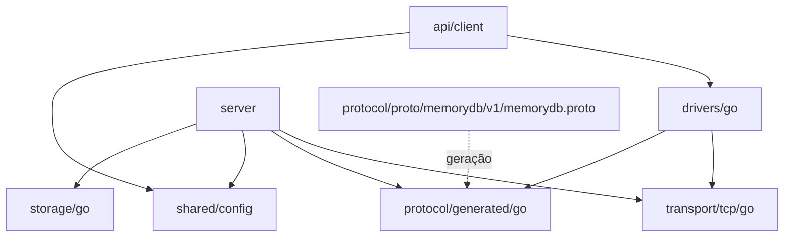
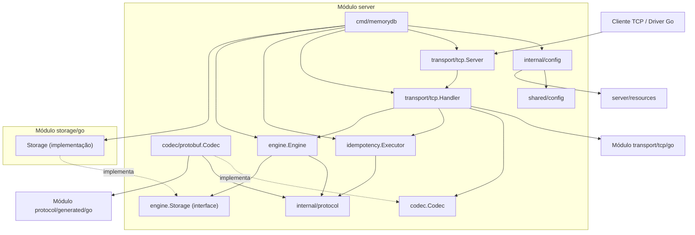
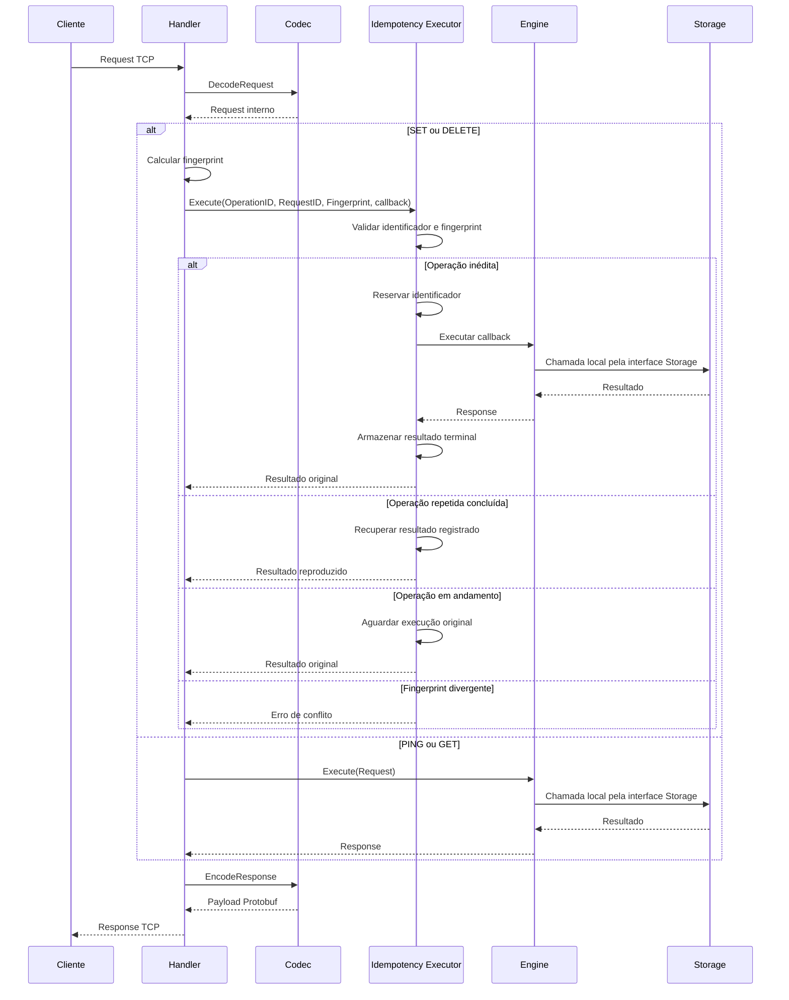

# Arquitetura do MemoryDB

## 1. Visão geral

MemoryDB é um banco de dados chave-valor em memória, implementado em Go. Na implementação atual, o servidor recebe comandos `PING`, `SET`, `GET` e `DELETE` por TCP, utilizando Protocol Buffers para serializar as mensagens.

A arquitetura separa responsabilidades de:

- composição, configuração e ciclo de vida do servidor;
- transporte TCP e framing;
- codificação e decodificação de mensagens;
- representação interna das solicitações e respostas;
- execução dos comandos;
- armazenamento em memória;
- controle de idempotência para operações mutáveis;
- comunicação de aplicações clientes por meio de um driver Go;
- definição compartilhada de nomes de variáveis de ambiente e valores padrão;
- detecção, dimensionamento e validação de recursos disponíveis no ambiente.

O armazenamento é implementado no módulo Go independente `storage/go`. O servidor utiliza esse módulo como biblioteca e injeta sua implementação no Engine por meio de uma interface definida no próprio módulo Server.

Engine e Storage executam no mesmo processo. Não existe um serviço separado de armazenamento, nem comunicação RPC, IPC ou tráfego de rede entre esses componentes. A interação ocorre por chamadas locais de métodos Go, compartilhando o espaço de endereçamento e o heap do processo.

A mesma instância de Engine é utilizada pelos handlers das conexões aceitas pelo servidor. Portanto, as conexões atendidas pelo mesmo processo compartilham o mesmo armazenamento.

O Handler utiliza um Executor de idempotência compartilhado entre as conexões do servidor. Esse componente coordena as operações `SET` e `DELETE`, evitando a execução repetida de uma mesma operação lógica enquanto seu registro permanecer retido na instância do servidor.

As operações `PING` e `GET` não passam pelo Executor de idempotência.

Os dados e os registros de idempotência permanecem exclusivamente na memória do processo. Não há persistência, recuperação após reinicialização ou replicação.

As configurações operacionais do servidor e do cliente de demonstração são carregadas por seus respectivos pacotes de configuração. Os nomes das variáveis de ambiente e os valores padrão compartilhados são centralizados no módulo `shared`. O driver Go, por ser uma biblioteca, recebe suas configurações explicitamente por meio de sua API pública e não consulta diretamente o ambiente.

A arquitetura descrita neste documento representa a implementação existente, não uma arquitetura-alvo.

## 2. Organização dos módulos Go

O repositório utiliza sete módulos Go coordenados pelo workspace da raiz (`go.work`).

| Módulo | Diretório | Responsabilidade |
|---|---|---|
| Servidor | `server/` | Composição do servidor, configuração, execução de comandos, interfaces internas, codec e integração TCP |
| Storage | `storage/go/` | Biblioteca independente de armazenamento chave-valor em memória |
| Transporte TCP | `transport/tcp/go/` | Framing e abstração reutilizável de conexão TCP |
| Driver Go | `drivers/go/` | Biblioteca cliente para aplicações Go |
| Protocolo gerado | `protocol/generated/go/` | Tipos Go gerados a partir do schema Protobuf |
| API de demonstração | `api/` | Executável que demonstra o uso do driver e carrega suas configurações |
| Módulo compartilhado | `shared/` | Nomes de variáveis de ambiente e valores padrão compartilhados |

O diretório `protocol/proto/` contém o contrato Protobuf independente da linguagem e não constitui um módulo Go separado.

Cada módulo Go mantém seu próprio `go.mod`. O `go.work` inclui os módulos locais utilizados no desenvolvimento e define substituições para dependências internas do projeto.

O driver e o servidor compartilham os módulos de transporte TCP e de tipos Protobuf gerados. O driver não importa os pacotes internos do servidor.

O módulo `shared` centraliza definições utilizadas por mais de um componente. Atualmente, `shared/config` contém nomes de variáveis de ambiente e valores padrão compartilhados. A interpretação e a validação das configurações permanecem sob responsabilidade de cada componente consumidor.

O módulo `storage/go` possui identidade e ciclo de dependências próprios. O servidor depende dele como biblioteca Go, mas a abstração utilizada pelo Engine pertence ao módulo Server.

### 2.1 Dependências entre módulos

O executável `api/client` carrega as configurações de conexão a partir do ambiente e injeta os valores obtidos na API pública do driver.

O módulo `drivers/go` não depende de `shared/config` para ler variáveis de ambiente. Ele recebe endereço e timeout explicitamente por meio de `DialConfig`.

O servidor utiliza `shared/config` para obter nomes de variáveis e valores padrão compartilhados, enquanto as configurações específicas do servidor são definidas e carregadas em `server/internal/config`.

O servidor utiliza o módulo `storage/go` como implementação concreta de armazenamento. A interface consumida pelo Engine é definida em `server/internal/engine/storage.go`, mantendo o Engine dependente de uma abstração própria, e não dos detalhes internos da implementação de Storage.

O schema `.proto` é a fonte do contrato externo. Os arquivos Go gerados devem ser tratados como artefatos de geração, não como arquivos para edição manual.

A presença de opções de geração para outras linguagens no schema não significa que existam drivers ou implementações dessas linguagens no estado atual.

### 2.2 Execução dos testes

O repositório utiliza múltiplos módulos Go coordenados por um workspace. Por isso, a execução dos testes e das verificações técnicas é realizada individualmente em cada módulo.

Os procedimentos de formatação, análise estática, testes unitários, detecção de condições de corrida, compilação e cobertura estão centralizados nos scripts de `scripts/test/`.

Consulte o [Guia de testes](./TESTES.md) para conhecer os comandos disponíveis, os critérios de validação e a geração dos relatórios.

## 3. Arquitetura interna do servidor

As responsabilidades internas do servidor estão distribuídas entre os seguintes pacotes:

| Pacote | Responsabilidade |
|---|---|
| `server/cmd/memorydb` | Inicialização, composição das dependências, carregamento de configurações e encerramento |
| `server/internal/config` | Carregamento, aplicação de padrões e validação das configurações operacionais do servidor |
| `server/resources` | API Go pública para detecção, cálculo, override e validação de limites e orçamentos de recursos |
| `server/internal/transport/tcp` | Aceitação de conexões e processamento de solicitações |
| `server/internal/codec` | Contrato de codificação e decodificação |
| `server/internal/codec/protobuf` | Adaptação entre o modelo interno e os tipos Protobuf |
| `server/internal/protocol` | Modelo interno de solicitações, comandos, respostas e resultados |
| `server/internal/engine` | Validação e execução dos comandos e definição da interface de armazenamento |
| `server/internal/idempotency` | Controle de identificadores de operação, fingerprints, deduplicação, concorrência, replay, capacidade e retenção |
| `storage/go` | Implementação independente do armazenamento chave-valor em memória |

### 3.1 Diagrama de responsabilidades

O diagrama representa responsabilidades e dependências. Não significa que o projeto implemente formalmente Clean Architecture, Hexagonal Architecture ou DDD.

### 3.2 Direção das dependências

O modelo interno (`server/internal/protocol`) não depende dos tipos gerados pelo Protobuf nem do transporte TCP.

O pacote `codec.Codec` define um contrato utilizado pelo Handler. A implementação concreta atual é `codec/protobuf.Codec`.

O transporte TCP reutilizável não conhece Protobuf, Engine, Storage ou os pacotes internos do servidor.

O Engine depende de uma interface de armazenamento definida em `server/internal/engine/storage.go`. Essa interface descreve as operações de armazenamento necessárias à execução dos comandos, sem exigir dependência direta da implementação concreta do módulo `storage/go`.

A implementação concreta de Storage pertence ao módulo independente `storage/go`. O executável do servidor instancia essa implementação e a injeta no Engine durante a composição das dependências.

Essa organização aplica o princípio de inversão de dependência na fronteira entre Engine e Storage: o consumidor define a abstração de que necessita, e a implementação concreta satisfaz esse contrato.

A separação em módulos não implica separação de processos. O Engine chama os métodos da implementação de Storage diretamente, dentro do mesmo processo Go.

O pacote `server/internal/idempotency` implementa o controle de idempotência das operações `SET` e `DELETE`.

O Handler calcula o fingerprint da operação e utiliza o Executor para reservar e verificar o `OperationID` antes de executar a operação no Engine. O Executor recebe a execução como uma função, mantendo o mecanismo de deduplicação desacoplado da implementação concreta do Engine.

O Executor mantém seus próprios registros em memória, separados dos dados de negócio armazenados pelo Storage.

A instância do Executor é criada durante a composição do servidor e compartilhada entre os handlers das conexões aceitas pelo mesmo processo.

Os nomes das variáveis de ambiente e os valores padrão compartilhados são definidos em `shared/config/defaults.go`. As regras de carregamento das configurações operacionais específicas do servidor ficam em `server/internal/config/config.go`.

O pacote `server/resources` é uma API Go pública dentro do módulo `server`. Ele detecta a capacidade disponível, calcula os limites dos componentes a partir de um perfil, aplica overrides e valida a configuração final. `server/internal/config` chama `LoadResourceConfigFromEnv()` durante o startup e agrega o resultado às configurações operacionais do servidor.

O pacote de recursos não é uma camada de execução nem um serviço separado. Ele não detecta hardware dentro do Storage, Engine ou Handler: a detecção ocorre antes da composição e os componentes recebem somente seus próprios limites.

### 3.3 Responsabilidades do Handler, Executor e Engine

A separação entre esses componentes é importante para compreender o fluxo de execução:

- **Handler:** interpreta a solicitação interna, encaminha `SET` e `DELETE` ao fluxo de idempotência e executa diretamente no Engine os comandos `PING` e `GET`. Para operações mutáveis, calcula o fingerprint por meio de `idempotency.Fingerprint()` e fornece esse valor ao Executor.
- **Executor:** valida o identificador da operação, compara fingerprints de operações previamente registradas, coordena operações concorrentes e controla a retenção, a capacidade e a reprodução dos resultados armazenados.
- **Engine:** valida os comandos de negócio e executa suas operações sobre o Storage por meio da interface definida pelo próprio Engine. Para operações mutáveis, é invocado pelo callback fornecido pelo Handler ao Executor.
- **Storage:** mantém os dados chave-valor em memória e protege o acesso concorrente. Sua implementação concreta é fornecida pelo módulo `storage/go`.

O cálculo do fingerprint é responsabilidade do fluxo de tratamento da solicitação, realizado pelo Handler por meio da função `idempotency.Fingerprint()`. O Executor recebe o fingerprint calculado e o utiliza para identificar repetições ou conflitos.

O Engine não implementa idempotência e não valida o tamanho do `OperationID`. Essa responsabilidade pertence ao fluxo de idempotência utilizado pelo Handler e pelo Executor.

## 4. Transporte e contrato de comunicação

A comunicação externa utiliza TCP. Cada mensagem é transmitida em um frame composto por:

- cabeçalho de 4 bytes;
- tamanho do payload representado por `uint32`;
- ordem de bytes Big Endian;
- payload com tamanho mínimo de 1 byte;
- tamanho máximo de 1 MiB.

O payload contém uma mensagem serializada em Protocol Buffers.

O framing é implementado em `transport/tcp/go/framing.go`. A abstração `Connection`, em `transport/tcp/go/connection.go`, encapsula `net.Conn` e fornece operações de leitura, escrita e fechamento.

### 4.1 Concorrência no transporte

A `Connection` utiliza mutexes independentes para leitura e escrita:

- operações de leitura concorrentes são serializadas;
- operações de escrita concorrentes são serializadas;
- uma leitura e uma escrita podem ocorrer simultaneamente;
- `Close` fecha diretamente a conexão subjacente e pode interromper operações de I/O bloqueadas.

A implementação de framing utiliza leitura completa e escrita em loop para tratar fragmentação e escritas parciais.

O transporte TCP é independente do protocolo de serialização. Isso permite reutilizá-lo sem acoplar o framing ao Protobuf.

### 4.2 Contrato Protobuf

O contrato externo está definido em `protocol/proto/memorydb/v1/memorydb.proto`.

O envelope `Request` contém:

- `request_id`;
- um comando selecionado por `oneof`.

O envelope `Response` contém:

- `request_id`;
- `success`;
- um resultado selecionado por `oneof`.

Os comandos definidos são `PING`, `SET`, `GET` e `DELETE`. O schema também define os respectivos resultados e uma estrutura de erro com código e mensagem.

O campo `request_id` permite correlacionar uma resposta com sua solicitação. Ele não é um identificador de operação estável entre tentativas e não oferece idempotência ou deduplicação.

Os comandos `SET` e `DELETE` também possuem o campo `operation_id`, representado como `bytes` no Protobuf.

Esse campo transporta o identificador de 128 bits utilizado pelo mecanismo de idempotência. O servidor valida se o identificador possui exatamente 16 bytes.

O `operation_id` é obrigatório para `SET` e `DELETE`. Sua ausência ou tamanho inválido resulta em erro de aplicação.

O campo não substitui o `request_id`: cada tentativa possui seu próprio identificador de requisição, enquanto as tentativas de uma mesma operação lógica reutilizam o mesmo identificador de operação.

### 4.3 Semântica dos comandos

| Comando | Comportamento implementado |
|---|---|
| `PING` | Retorna uma resposta `PONG` |
| `SET` | Armazena o valor associado à chave |
| `GET` | Retorna o valor e informa se a chave existe |
| `DELETE` | Remove a chave e informa se ela existia |

As validações de aplicação são distribuídas entre o fluxo de idempotência e o Engine.

O Engine realiza as seguintes validações:

- solicitação nula, comando ausente, desconhecido ou tipado nulo: `INVALID_REQUEST`;
- chave vazia em `SET`, `GET` ou `DELETE`: `INVALID_ARGUMENT`;
- `SET` com `ttl_ms` maior que zero: `UNSUPPORTED_FEATURE`;
- `SET` com TTL igual a zero: gravação sem expiração.

O `GET` diferencia uma chave inexistente de uma chave existente cujo valor é vazio. O `DELETE` informa se a chave foi efetivamente removida.

As operações `SET` e `DELETE` exigem um `OperationID` válido. O Handler encaminha essas operações ao Executor de idempotência antes de solicitar sua execução ao Engine.

`PING` e `GET` são executados diretamente pelo Engine, sem passar pelo Executor.

A validação do `OperationID` pertence ao fluxo de idempotência do Handler/Executor, não ao Engine. O Engine permanece responsável pela validação e execução dos comandos de negócio.

Erros de framing ou de decodificação Protobuf encerram o processamento da conexão. Eles não são necessariamente convertidos em uma resposta estruturada de aplicação.

## 5. Fluxo de processamento de uma solicitação

O Handler processa solicitações sequencialmente em cada conexão.

Para `SET` e `DELETE`, o Handler calcula o fingerprint da operação por meio de `idempotency.Fingerprint()` e solicita sua execução ao Executor de idempotência, fornecendo o `OperationID`, o `RequestID`, o fingerprint e uma função que executa a operação no Engine.

O Executor valida o `OperationID` e coordena atomicamente a reserva do identificador. A execução da operação ocorre fora do mutex interno do Executor, por meio do callback fornecido pelo Handler, permitindo que operações distintas avancem concorrentemente.

Quando uma operação com o mesmo identificador e fingerprint já está em andamento, a nova tentativa aguarda sua conclusão. Quando já existe um resultado terminal registrado, ele é reproduzido sem executar novamente a mutação.

Em caso de replay, o resultado semântico original é preservado, mas o `RequestID` da resposta é atualizado para corresponder à tentativa atual.

Se o mesmo identificador for apresentado com parâmetros semanticamente diferentes, a operação é rejeitada por conflito.

O Handler executa o seguinte ciclo de processamento por conexão:

1. cria uma abstração `Connection` para a conexão recebida;
2. lê um frame;
3. decodifica a solicitação;
4. encaminha `SET` e `DELETE` ao Executor de idempotência, que coordena sua execução no Engine; para `PING` e `GET`, chama diretamente o Engine;
5. codifica a resposta;
6. escreve o frame de resposta;
7. repete o processamento enquanto a conexão permanecer aberta.

Uma falha de leitura, decodificação, codificação ou escrita encerra o processamento daquela conexão.

O Handler retorna o erro ao servidor. Atualmente, a goroutine criada por `Server.Serve()` descarta esse retorno, sem registro estruturado da falha.

### 5.1 Resultados e erros do fluxo de idempotência

O Executor pode produzir resultados associados aos seguintes cenários:

| Condição | Resultado |
|---|---|
| Identificador ausente ou com tamanho inválido | `INVALID_OPERATION_ID` |
| Mesmo identificador com fingerprint diferente | `OPERATION_ID_CONFLICT` |
| Capacidade esgotada para identificador inédito | `IDEMPOTENCY_CAPACITY_REACHED` |
| Resultado da operação não pode ser determinado com segurança | `OPERATION_OUTCOME_UNKNOWN` |

Esses códigos representam erros estruturados do fluxo de aplicação no servidor. São diferentes do erro local `OperationOutcomeUnknownError`, utilizado pelo driver para representar uma falha de comunicação na qual o cliente não consegue confirmar o resultado da operação.

O Handler converte os erros do Executor em respostas do protocolo. Outros erros não classificados seguem o tratamento de erro interno previsto pelo Handler.

## 6. Armazenamento e ciclo de vida dos dados

O armazenamento é implementado pelo módulo Go independente `storage/go`, cujo módulo é identificado por `github.com/pescador95/memorydb/storage/go`.

A implementação mantém os dados em um mapa indexado por chave (`string`), com valores em `[]byte`.

O acesso concorrente é protegido por `sync.RWMutex`.

O Storage:

- copia os bytes recebidos em `Set`;
- copia os bytes retornados em `Get`;
- informa se uma chave existe;
- remove entradas por `Delete`.

A estrutura `Entry` guarda o valor. Não há campo de expiração.

A interface consumida pelo Engine está definida em `server/internal/engine/storage.go`. Ela representa as operações de armazenamento necessárias ao Engine e não pertence ao módulo de implementação Storage.

A implementação concreta é criada durante a composição do servidor, em `server/cmd/memorydb/main.go`, e injetada no Engine. Dessa forma, o Engine não precisa importar diretamente a implementação concreta para executar os comandos.

A extração para um módulo Go independente permite reutilizar e evoluir o Storage separadamente, sem transformá-lo em um serviço de rede.

Engine e Storage permanecem no mesmo processo. As chamadas entre eles são chamadas locais de métodos, sem serialização de mensagens, sockets, RPC ou IPC.

O servidor cria uma instância de Engine durante sua composição e utiliza esse Engine para processar as conexões. Assim, as conexões de um mesmo processo compartilham os dados.

Os registros de idempotência não são armazenados nesse mapa. O Executor mantém seu próprio estado em memória, independente do Storage.

### 6.1 Limites do armazenamento atual

- Os dados são voláteis e existem apenas na memória do processo.
- O encerramento ou reinício do processo elimina os dados.
- Não há persistência em disco.
- Não há replicação.
- Não há compartilhamento de dados entre processos ou instâncias.
- TTL positivo não é implementado.
- No servidor, `NewWithConfig` aplica máximo de entradas, orçamento lógico e tamanhos máximos de chave e valor.
- O orçamento do Storage contabiliza `len(key)+len(value)` e não inclui overhead de `map`, estruturas Go, cópias ou runtime.
- O limite do Storage não representa limite global de memória do processo.

## 7. Driver Go e modelo de comunicação

O módulo `drivers/go` fornece uma biblioteca para aplicações Go se comunicarem com o servidor.

O driver depende do transporte TCP reutilizável e dos tipos Protobuf gerados. Não depende dos pacotes internos do servidor.

A API de conexão inclui:

- `Dial(address)`;
- `DialContext(ctx, address)`;
- `DialWithConfig(config)`;
- `DialContextWithConfig(ctx, config)`;
- `New(conn)`.

As funções `Dial` e `DialContext` são mantidas para compatibilidade com a API anterior. As funções `DialWithConfig` e `DialContextWithConfig` permitem configurar explicitamente o endereço e o timeout de estabelecimento da conexão.

A configuração pública de conexão é representada por `DialConfig`, que contém:

| Campo | Tipo | Responsabilidade |
|---|---|---|
| `Address` | `string` | Endereço TCP do servidor |
| `Timeout` | `time.Duration` | Timeout para estabelecimento da conexão |

A configuração é fornecida pela aplicação consumidora. O driver não lê variáveis de ambiente nem aplica padrões operacionais específicos do executável de demonstração.

Um timeout igual a zero representa ausência de timeout específico no `net.Dialer`, mantendo o comportamento anterior. Valores negativos são rejeitados.

A API também inclui:

- `Close`;
- `Ping` e `PingContext`;
- `Set` e `SetContext`;
- `Get` e `GetContext`;
- `Delete` e `DeleteContext`.

As operações são serializadas por conexão por meio de `operationGate`. O driver permite chamadas concorrentes, mas apenas uma operação utiliza a conexão por vez.

Esse comportamento é necessário porque o protocolo atual trabalha com uma solicitação e sua resposta por vez na mesma conexão. Não existe multiplexação.

### 7.1 Identificação e correlação

O driver utiliza dois identificadores com responsabilidades distintas:

| Identificador | Responsabilidade | Ciclo de vida |
|---|---|---|
| `RequestID` | Correlacionar uma requisição com sua resposta | Novo para cada tentativa |
| `OperationID` | Identificar uma operação lógica mutável | Reutilizado nas tentativas da mesma operação |

O `RequestID` é gerado pelo cliente e utilizado para correlacionar a resposta recebida. Ele não é estável entre tentativas.

O `OperationID` é representado pelo tipo `memorydb.OperationID`, com 16 bytes. A função `NewOperationID()` gera um identificador utilizando `crypto/rand`.

As operações `Set`, `SetContext`, `Delete` e `DeleteContext` recebem o identificador como argumento obrigatório.

A aplicação consumidora é responsável por manter e reutilizar o mesmo `OperationID` quando decidir repetir uma tentativa da mesma operação lógica.

Para uma nova operação lógica, deve ser gerado um novo identificador.

O driver não realiza retries automáticos e não gera identificadores implicitamente para as operações mutáveis.

### 7.2 Estados do cliente

O driver mantém três estados internos:

| Estado | Significado |
|---|---|
| `open` | Cliente disponível para operações |
| `closed` | Cliente encerrado explicitamente |
| `failed` | Conexão invalidada após falha de comunicação ou protocolo |

O cliente não deve ser reutilizado após entrar em `closed` ou `failed`.

### 7.3 Contextos e cancelamento

`DialContext` utiliza o contexto apenas para controlar o estabelecimento da conexão. Esse contexto não fica associado às operações posteriores.

Cada operação pode receber seu próprio contexto.

O driver distingue:

- **Cancelamento enquanto aguarda acesso à conexão:** a operação não começou, o erro de contexto é retornado e a conexão permanece disponível.
- **Cancelamento durante I/O:** a conexão é fechada para interromper a comunicação e o resultado pode ser indeterminado.

O fechamento explícito do cliente também pode interromper uma operação de rede em andamento.

### 7.4 Resultado indeterminado

O driver disponibiliza `OperationOutcomeUnknownError` para representar uma operação cuja execução não pode ser confirmada.

O erro contém `RequestID` e `Cause`, além de implementar `Unwrap()` para preservar a inspeção da causa original.

O resultado pode ser indeterminado quando, por exemplo:

- parte da solicitação foi transmitida antes de uma falha de escrita;
- a solicitação foi enviada e a resposta não chegou;
- o contexto foi cancelado durante a comunicação;
- a conexão foi interrompida;
- a resposta recebida não pôde ser decodificada ou validada.

Esse erro não significa que o servidor deixou de executar a operação. Significa que o cliente não possui confirmação suficiente para determinar o resultado.

O driver não realiza retry automático. Repetir uma operação após resultado indeterminado exige que a aplicação considere a possibilidade de a operação original já ter sido executada.

Quando uma operação mutável retorna `OperationOutcomeUnknownError`, a aplicação pode utilizar o mesmo `OperationID` em uma nova tentativa, desde que mantenha os mesmos parâmetros semânticos da operação original.

Para `SET`, isso inclui manter a mesma chave, o mesmo valor e o mesmo TTL.

A repetição poderá ser protegida pelo Executor enquanto o registro correspondente estiver retido na mesma instância do servidor. Essa proteção não pode ser presumida após a expiração do registro ou a reinicialização do processo.

Essa garantia não equivale a uma garantia de execução exatamente uma vez.

### 7.5 Erros de aplicação

Quando o servidor retorna uma resposta estruturada de erro válida, o driver a representa por `ServerError`.

Esse cenário é diferente de uma falha de comunicação: o cliente recebeu uma resposta de aplicação reconhecível e não invalida automaticamente a conexão.

O erro `OPERATION_OUTCOME_UNKNOWN` retornado pelo servidor e o erro local `OperationOutcomeUnknownError` do driver representam situações relacionadas, mas distintas:

- o primeiro é um código de erro do protocolo produzido pelo servidor;
- o segundo é um erro do cliente que indica que uma falha de comunicação impediu a confirmação do resultado.

## 8. Inicialização e encerramento do servidor

O executável está em `server/cmd/memorydb/main.go`.

As configurações operacionais são carregadas por `server/internal/config`. A configuração de recursos é carregada pelo pacote público `server/resources`, chamado por `server/internal/config.Load()` durante o startup.

Os nomes e valores padrão compartilhados são definidos em `shared/config/defaults.go`. Variáveis ausentes ou vazias utilizam o padrão correspondente; valores presentes, mas inválidos ou inconsistentes, impedem a inicialização.

| Variável operacional | Padrão | Descrição |
|---|---:|---|
| `MEMORYDB_ADDR` | `:6380` | Endereço TCP utilizado pelo listener |
| `MEMORYDB_READ_TIMEOUT` | `30s` | Timeout de leitura TCP do Handler |
| `MEMORYDB_WRITE_TIMEOUT` | `10s` | Timeout de escrita TCP do Handler |
| `MEMORYDB_SHUTDOWN_TIMEOUT` | `10s` | Tempo máximo aguardado pelo encerramento gracioso |

O perfil padrão de recursos é `mid`. Limites como máximo de conexões, requisições em processamento, payload máximo, capacidade e orçamento de idempotência são determinados pelo perfil e podem ser sobrescritos por variáveis como `MEMORYDB_MAX_CONNECTIONS`, `MEMORYDB_MAX_IN_FLIGHT_REQUESTS`, `MEMORYDB_MAX_FRAME_PAYLOAD_SIZE`, `MEMORYDB_IDEMPOTENCY_MAX_ENTRIES` e `MEMORYDB_IDEMPOTENCY_RETENTION`.

As durações operacionais utilizam o formato aceito por `time.ParseDuration`. A configuração de recursos também aceita unidades de memória e quantidades de CPU. Consulte [Dimensionamento e detecção de recursos](./RECURSOS.md) para a tabela completa e os valores dos perfis.

A configuração do endereço é carregada como texto. A validação de sua utilização como endereço TCP ocorre quando o executável tenta criar o listener por meio de `net.Listen`.

O ponto de entrada realiza a composição do servidor:

1. carrega e valida as configurações operacionais e a configuração de recursos;
2. instancia o Storage com os limites calculados;
3. cria o Executor de idempotência com capacidade, orçamento e retenção configurados;
4. instancia o codec Protobuf e o Engine, injetando Storage por meio da interface definida em `server/internal/engine/storage.go`;
5. cria o Handler com Engine, Codec, Executor e limites de processamento;
6. cria o listener TCP utilizando o endereço configurado;
7. cria o servidor com o limite configurado de conexões simultâneas;
8. registra o contexto de sinais para `SIGINT` e `SIGTERM`;
9. inicia `Server.Serve()` em uma goroutine;
10. ao receber sinal, solicita encerramento com o timeout configurado.

O Executor é criado uma única vez durante a composição do servidor e compartilhado pelos handlers das conexões atendidas pelo mesmo processo.

### 8.1. Semântica do shutdown

`Server.Shutdown(ctx)` inicia o encerramento do servidor, impede a admissão de novas conexões, fecha o listener TCP e aguarda a conclusão das conexões ativas.

Durante o encerramento gracioso, os handlers das conexões existentes podem concluir suas operações normalmente. O servidor aguarda que todas as goroutines responsáveis pelas conexões terminem.

Se o contexto expirar antes da conclusão do encerramento gracioso, o servidor inicia o encerramento forçado:

1. obtém uma cópia das conexões ainda ativas;
2. fecha essas conexões para interromper operações de leitura e escrita bloqueadas;
3. aguarda a conclusão das goroutines responsáveis pelo atendimento das conexões;
4. retorna o erro do contexto, preservando também eventual erro no fechamento do listener.

O encerramento forçado não representa cancelamento genérico de qualquer operação executada pelo Handler. Sua capacidade de interrupção depende de as operações bloqueadas responderem ao fechamento da conexão.

O timeout de shutdown é configurado por `MEMORYDB_SHUTDOWN_TIMEOUT`, cujo valor padrão é `10s`.

### 8.2. Limite de conexões simultâneas

O servidor mantém o controle das conexões TCP ativas e admite no máximo a quantidade configurada em `MEMORYDB_MAX_CONNECTIONS`.

O valor padrão é de 1024 conexões simultâneas.

Quando o limite é atingido, novas conexões não são admitidas para processamento. O limite se refere a conexões TCP aceitas pelo servidor, não à quantidade de operações em andamento, nem à quantidade de solicitações que podem ser multiplexadas em uma conexão.

O limite não representa um teto de memória do processo. Cada conexão e seus recursos associados continuam contribuindo para o consumo total de memória.

### 8.3. Timeouts de leitura e escrita

O Handler aplica deadlines de leitura e escrita às operações TCP.

Os valores padrão são:

- leitura: `30s`;
- escrita: `10s`.

Os valores são configuráveis por `MEMORYDB_READ_TIMEOUT` e `MEMORYDB_WRITE_TIMEOUT`, respectivamente.

Esses timeouts limitam a duração das operações de I/O correspondentes. Não constituem um timeout global de execução de comandos, nem um limite de duração de todas as operações internas do servidor.

## 9. Dimensionamento e aplicação de recursos

O pacote `server/resources` calcula uma configuração de recursos no startup. O perfil padrão é `mid`; também são suportados `low`, `high`, `auto` e `custom`.

Os presets `low`, `mid` e `high` são determinísticos e podem ser rejeitados quando excedem os recursos detectados. `auto` usa a capacidade detectada de CPU e memória; `custom` recebe esses dois valores explicitamente, mas também precisa respeitar a capacidade detectada. Os perfis `auto` e `custom` utilizam o mesmo algoritmo de distribuição.

O orçamento de memória do processo é dividido em quatro parcelas: Storage (55%), Idempotência (15%), Processamento (15%) e Runtime (15%). A soma é validada para corresponder exatamente ao orçamento do processo.

A configuração é distribuída no ponto de composição:
- Storage recebe `MaxEntries`, `MemoryBudget`, `MaxKeySize` e `MaxValueSize`;
- Executor recebe `MaxEntries`, `MemoryBudget` e `Retention`;
- Handler recebe `MaxInFlightRequests`, `MaxFramePayloadSize` e `Processing.MemoryBudget`;
- Server TCP recebe `MaxConnections`.

O pacote de recursos é desacoplado dos componentes. Ele não introduz detecção de cgroups ou hardware nas camadas de armazenamento e processamento.

### 9.1. Detecção de capacidade

No Linux, a detecção utiliza `runtime.NumCPU()`, `MemAvailable` de `/proc/meminfo` e os limites aplicáveis de cgroups v1/v2. CPU é calculada a partir de quota/período; memória disponível no cgroup é limite menos uso atual. A detecção considera o cgroup atual e seus ancestrais, usando o menor limite aplicável e comparando-o com a capacidade disponível do host. Sem metadados de cgroups, utiliza os recursos do host.

No Windows, CPU é obtida por `runtime.NumCPU()` e memória disponível por `GlobalMemoryStatusEx`. A implementação atual não consulta Windows Job Objects. Outros sistemas operacionais não possuem implementação de detecção e retornam erro de plataforma não suportada.

São descontadas margens de segurança de 10% para CPU e 20% para memória detectadas.

### 9.2. Limites lógicos versus limites do processo

Os orçamentos de Storage, Idempotência e Processamento são aplicados por contabilização lógica. Eles não equivalem a uma medição exata do heap Go ou do RSS.

O orçamento de Storage contabiliza `len(key)+len(value)`. O de Idempotência contabiliza uma estimativa da estrutura base e dos dados variáveis da resposta. O Handler reserva capacidade lógica para o frame e buffers de processamento antes de alocar o payload.

A parcela Runtime é o restante do orçamento, mas ainda não é aplicada por `GOMEMLIMIT` ou `debug.SetMemoryLimit`. O orçamento total do processo não é um limite rígido de memória do sistema operacional. Da mesma forma, `CPUCapacity` é uma capacidade utilizada no cálculo e na validação; não configura `GOMAXPROCS`, afinidade ou limite de CPU.

Consulte [Dimensionamento e detecção de recursos](./RECURSOS.md) para os presets, variáveis de ambiente, API Go e detalhes de implementação.

## 10. Limites arquiteturais atuais

| Área | Estado atual |
|---|---|
| Persistência | Não implementada |
| Replicação | Não implementada |
| Distribuição entre instâncias | Não implementada |
| Autenticação e autorização | Não implementadas |
| TLS | Não implementado |
| TTL | Campo no protocolo; funcionalidade não implementada |
| Idempotência | Implementada para `SET` e `DELETE` |
| Deduplicação server-side | Implementada na instância do servidor |
| Retry automático | Não implementado |
| Multiplexação | Não implementada |
| Timeout de estabelecimento de conexão do cliente | Configurável por `DialConfig` |
| Limite de conexões TCP simultâneas | Implementado e configurável; padrão de 1024 conexões |
| Timeouts de leitura e escrita TCP no servidor | Implementados e configuráveis; padrões de 30s e 10s, respectivamente |
| Shutdown gracioso e forçado | Implementado; aguarda conexões ativas e força o fechamento quando o prazo expira |
| Limite global de memória | Não implementado |
| Observabilidade estruturada por conexão | Não implementada no fluxo atual |

### 10.1 Idempotência e deduplicação

**Estado: implementado e validado em 22/11/2026.**

O MemoryDB implementa idempotência para operações `SET` e `DELETE`, por meio do pacote `server/internal/idempotency`.

O mecanismo é executado pelo Handler antes da chamada ao Engine e mantém registros independentes dos dados de negócio do Storage.

#### Identificador

O `OperationID` possui exatamente 16 bytes (128 bits) e é obrigatório para operações `SET` e `DELETE`.

O `RequestID` continua sendo utilizado para correlacionar cada tentativa com sua resposta. Os identificadores possuem finalidades distintas.

#### Fingerprint

O Handler utiliza `idempotency.Fingerprint()` para calcular um fingerprint SHA-256 determinístico dos campos semânticos da operação.

O fingerprint considera:

- tipo da operação;
- chave;
- valor, para `SET`;
- TTL, para `SET`.

O `OperationID` não integra o fingerprint.

O fingerprint permite verificar se uma tentativa que reutiliza um identificador corresponde à mesma operação lógica. A utilização de um identificador já registrado com parâmetros diferentes resulta em conflito.

O Executor recebe o fingerprint calculado pelo Handler e o utiliza para comparar a operação recebida com os registros existentes.

#### Retenção e capacidade

A implementação utiliza:

- retenção padrão de 24 horas após a conclusão da operação;
- capacidade de 100.000 registros no perfil `mid`;
- armazenamento exclusivamente em memória;
- compartilhamento dos registros entre as conexões da mesma instância.

A retenção e a capacidade podem ser configuradas no servidor por meio de `MEMORYDB_IDEMPOTENCY_RETENTION` e `MEMORYDB_IDEMPOTENCY_MAX_ENTRIES`, respectivamente. `MEMORYDB_IDEMPOTENCY_CAPACITY` é aceito como alias legado; se os dois nomes forem informados com valores diferentes, a configuração é rejeitada.

A capacidade contabiliza operações em andamento e concluídas.

Registros válidos não são removidos antecipadamente para liberar espaço. Quando a capacidade está esgotada, operações inéditas são rejeitadas antes da execução e não reservam o identificador.

Operações em andamento não expiram pela janela de retenção.

#### Comportamento

| Condição | Comportamento |
|---|---|
| `OperationID` inédito | Reserva e executa a operação |
| Mesmo ID e mesmo fingerprint, operação concluída | Reproduz o resultado original |
| Mesmo ID e mesmo fingerprint, operação em andamento | Aguarda a execução original |
| Mesmo ID e fingerprint diferente | Retorna conflito |
| ID inválido | Rejeita a operação |
| Capacidade esgotada | Rejeita operação inédita antes da execução |

O replay preserva o resultado semântico original e atualiza o `RequestID` para a tentativa atual.

Respostas terminais reproduzíveis, inclusive erros determinísticos, são armazenadas para replay.

O Executor não libera uma reserva quando não é possível determinar se a mutação foi executada. Essa condição é representada por resultado indeterminado.

#### Garantias e limitações

A garantia é de no máximo uma execução por `OperationID` enquanto o registro permanecer retido na mesma instância do servidor.

A implementação não oferece:

- persistência dos registros de idempotência;
- recuperação após reinicialização ou crash;
- deduplicação entre instâncias diferentes;
- garantia de execução exatamente uma vez;
- retry automático no driver.

A aplicação consumidora é responsável por fornecer e reutilizar o mesmo identificador nas tentativas da mesma operação lógica, preservando os parâmetros semânticos.

## 11. Evoluções arquiteturais

As evoluções abaixo exigem decisões de contrato e mudanças coordenadas entre componentes.

| Evolução | Componentes envolvidos | Objetivo |
|---|---|---|
| Persistência | Storage e recuperação | Preservar dados após reinicialização |
| TTL | Schema, modelo interno, Engine e Storage | Expirar entradas |
| Observabilidade | Server, Handler e driver | Diagnosticar falhas e acompanhar operação |
| Multiplexação | Protocolo, Handler e driver | Permitir várias operações em andamento na mesma conexão |
| Segurança | Server, transporte e autenticação | Proteger comunicação e acesso |
| Escalabilidade | Storage, protocolo e coordenação | Suportar múltiplas instâncias e distribuição |
