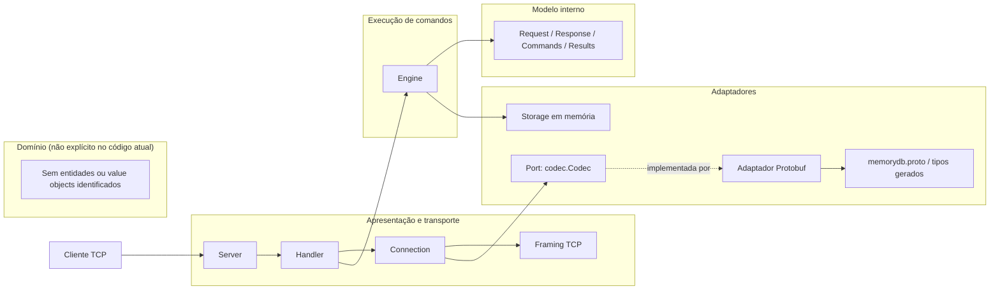
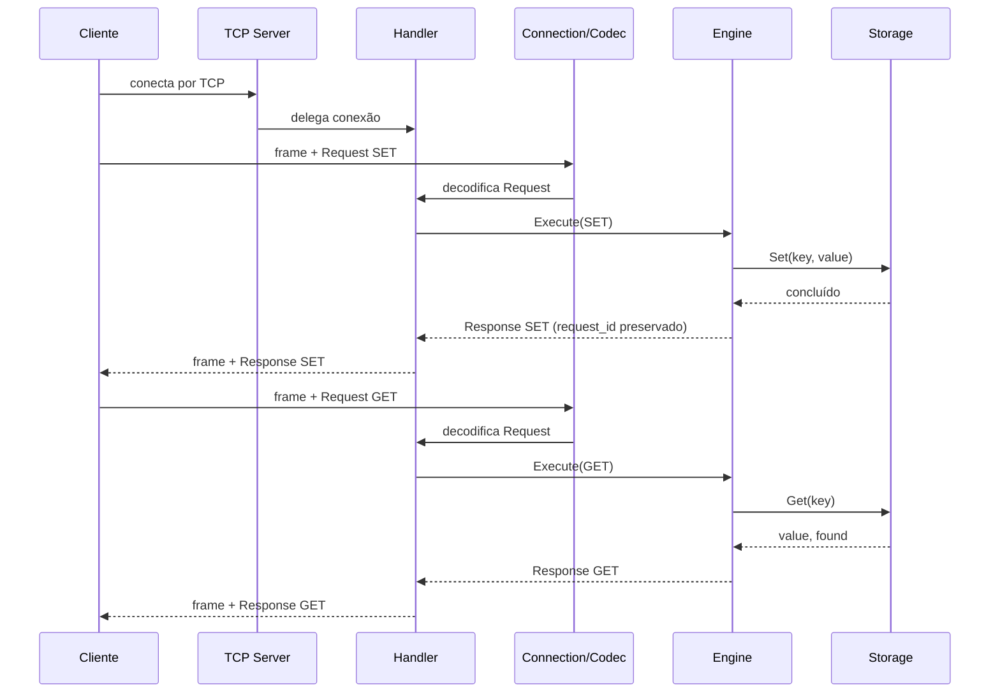
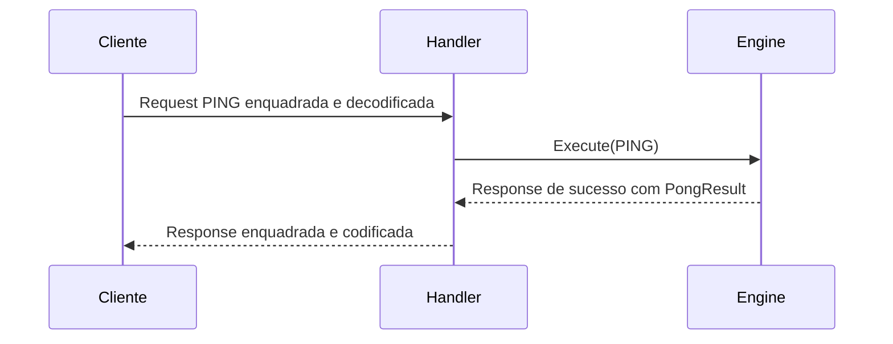
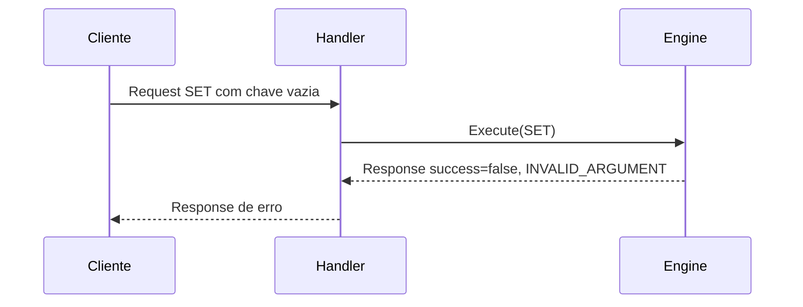
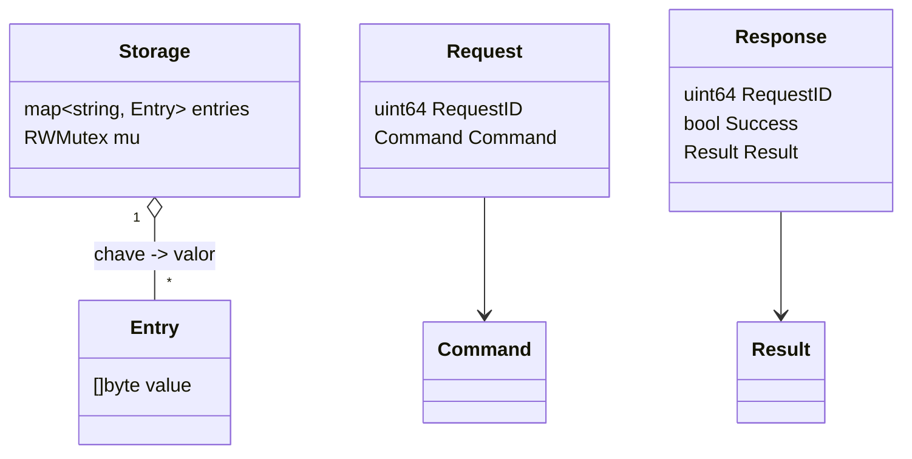

# Arquitetura do MemoryDB

## Visão geral

MemoryDB é um servidor chave-valor em memória que aceita comandos PING, SET, GET e DELETE por TCP. O processo compartilha um único armazenamento entre as conexões ativas; não há persistência, portanto os dados são perdidos ao reiniciar o servidor. Evidências: [Engine.Execute](../../internal/engine/engine.go), [Storage](../../internal/storage/storage.go), [main.run](../../cmd/memorydb/main.go).

O módulo declara Go 1.27.0 e depende de `google.golang.org/protobuf` v1.36.12. O transporte usa a biblioteca padrão `net`; o protocolo externo é definido em Protocol Buffers. Evidências: [go.mod](../../go.mod), [memorydb.proto](../../api/proto/memorydb.proto).

O repositório não contém pacotes chamados `domain`, `application`, `infra` ou `presentation`. As camadas no diagrama abaixo são uma classificação das responsabilidades atuais, não uma estrutura de pastas implementada.

## Diagrama de camadas e Ports



O contrato `codec.Codec` desacopla a conexão da implementação de serialização. O adaptador Protobuf implementa esse contrato. Em contraste, `Engine` referencia diretamente `*storage.Storage`: ainda não há uma Port de armazenamento. Evidências: [codec.Codec](../../internal/codec/codec.go), [protobuf.Codec](../../internal/codec/protobuf/codec.go), [Engine](../../internal/engine/engine.go).

## Catálogo de componentes

### Modelo interno — `internal/protocol`

Responsável por representar solicitações e respostas sem usar tipos Protobuf. `Request` contém `RequestID` e um `Command`; `Response` contém `RequestID`, `Success` e um `Result`. Os comandos são PING, SET, GET e DELETE. Os resultados incluem PONG, SET, GET, DELETE e erro. Evidência: [message.go](../../internal/protocol/message.go).

### Engine — `internal/engine`

`New() *Engine` cria o mecanismo com seu armazenamento; `(*Engine).Execute(request *protocol.Request) *protocol.Response` valida e executa comandos. Regras observadas:

- Request nulo, comando ausente/desconhecido ou comando tipado nulo resulta em `INVALID_REQUEST`.
- Chave vazia em SET, GET ou DELETE resulta em `INVALID_ARGUMENT`.
- SET com `TTLMillis > 0` resulta em `UNSUPPORTED_FEATURE`; TTL igual a zero permite gravar sem expiração.
- GET preserva a distinção entre chave inexistente (`Found == false`) e valor vazio (`Found == true`, slice vazia).
- DELETE retorna sucesso com `Deleted == false` quando a chave não existe.
- O `RequestID` é copiado para a resposta.

Evidência: [engine.go](../../internal/engine/engine.go), [command.go](../../internal/engine/command.go).

### Storage — `internal/storage`

`New() *Storage` cria o mapa em memória. Os métodos públicos são `Set(key string, value []byte)`, `Get(key string) ([]byte, bool)` e `Delete(key string) bool`. Um `sync.RWMutex` protege o mapa, e SET/GET copiam os bytes para evitar compartilhamento dos slices com o chamador. `Entry` armazena o valor; não há campo de expiração. Evidências: [storage.go](../../internal/storage/storage.go), [entry.go](../../internal/storage/entry.go).

### Codec — `internal/codec` e `internal/codec/protobuf`

A Port `codec.Codec` define:

```go
EncodeRequest(*protocol.Request) ([]byte, error)
DecodeRequest([]byte) (*protocol.Request, error)
EncodeResponse(*protocol.Response) ([]byte, error)
DecodeResponse([]byte) (*protocol.Response, error)
```

`protobuf.New() *protobuf.Codec` implementa essas operações, convertendo entre os modelos internos e os tipos gerados. Nil, mensagem Protobuf inválida e command/result ausente ou não suportado retornam erro de Go. Evidências: [codec.go](../../internal/codec/codec.go), [protobuf/codec.go](../../internal/codec/protobuf/codec.go).

### Transporte TCP — `internal/transport/tcp`

- `ReadFrame(io.Reader) ([]byte, error)` e `WriteFrame(io.Writer, []byte) error` leem/escrevem um frame com prefixo de 4 bytes, inteiro `uint32` Big Endian. Tamanho zero é inválido; o máximo é 1 MiB. Evidência: [framing.go](../../internal/transport/tcp/framing.go).
- `NewConnection(net.Conn, codec.Codec) (*Connection, error)` valida dependências. `ReadRequest`, `WriteRequest`, `ReadResponse`, `WriteResponse` combinam framing e codec; mutexes separados serializam leituras e escritas. Evidência: [connection.go](../../internal/transport/tcp/connection.go).
- `NewHandler(*engine.Engine, codec.Codec) (*Handler, error)` valida as dependências. `Handle(net.Conn) error` processa requisições sequencialmente até EOF/erro e fecha a conexão ao terminar. Erros de leitura, decodificação ou escrita retornam ao chamador; não é enviada uma resposta de protocolo quando a decodificação falha. Evidência: [handler.go](../../internal/transport/tcp/handler.go).
- `NewServer(net.Listener, *Handler) (*Server, error)` valida dependências. `Serve() error` aceita clientes e inicia uma goroutine por conexão. Uma segunda chamada simultânea retorna `ErrServerAlreadyServing`. `Shutdown(context.Context) error` fecha o listener e aguarda conexões ativas ou o cancelamento do contexto. Evidência: [server.go](../../internal/transport/tcp/server.go).

### Entradas executáveis

`cmd/memorydb` compõe codec, engine, handler e servidor. `MEMORYDB_ADDR` configura o endereço; o padrão é `:6380`. O processo trata `os.Interrupt` e `SIGTERM` e usa timeout de 10 segundos para shutdown. Evidência: [cmd/memorydb/main.go](../../cmd/memorydb/main.go).

`cmd/client` conecta a `127.0.0.1:6380` e executa um cenário de demonstração de PING, SET, GET e DELETE. Ele valida o ID da resposta e transforma respostas de erro em erro local. Evidência: [cmd/client/main.go](../../cmd/client/main.go).

Não foram encontrados endpoints HTTP, filas, jobs ou eventos no código analisado.

## Fluxos principais

### SET seguido de GET



Evidências: [Handler.Handle](../../internal/transport/tcp/handler.go), [Engine.Execute](../../internal/engine/engine.go), [Storage](../../internal/storage/storage.go), [Connection](../../internal/transport/tcp/connection.go).

### PING



Evidência: [Engine.Execute](../../internal/engine/engine.go).

### Erro de argumento



Evidência: [Engine.Execute](../../internal/engine/engine.go), [ErrorResult](../../internal/protocol/message.go).

## Contrato de comunicação

O projeto não expõe API HTTP. As operações abaixo são comandos enviados em mensagens Protobuf sobre TCP. O frame é um tamanho `uint32` Big Endian seguido pelo payload Protobuf; o payload permitido tem de 1 byte a 1 MiB. Evidências: [framing.go](../../internal/transport/tcp/framing.go), [memorydb.proto](../../api/proto/memorydb.proto).

| Comando | Campos da requisição | Resposta de sucesso | Erros de aplicação | Autenticação |
|---|---|---|---|---|
| PING | `request_id`; `ping` vazio | `success=true`, resultado `pong`; mesmo `request_id` | `INVALID_REQUEST` para requisição/comando inválido | Não implementada |
| SET | `request_id`; `set.key` string; `set.value` bytes; `set.ttl_ms` uint64 | `success=true`, resultado `set`; valor substitui o anterior | Chave vazia: `INVALID_ARGUMENT`; TTL positivo: `UNSUPPORTED_FEATURE`; requisição/comando inválido: `INVALID_REQUEST` | Não implementada |
| GET | `request_id`; `get.key` string | `success=true`, `get.found` e, quando encontrado, `get.value` bytes | Chave vazia: `INVALID_ARGUMENT`; requisição/comando inválido: `INVALID_REQUEST` | Não implementada |
| DELETE | `request_id`; `delete.key` string | `success=true`, `delete.deleted` indica se havia chave | Chave vazia: `INVALID_ARGUMENT`; requisição/comando inválido: `INVALID_REQUEST` | Não implementada |

O envelope de erro contém `success=false` e `error.code`/`error.message`. `INVALID_REQUEST`, `INVALID_ARGUMENT` e `UNSUPPORTED_FEATURE` são definidos em [command.go](../../internal/engine/command.go); as condições de uso estão em [engine.go](../../internal/engine/engine.go). Erros de frame ou Protobuf inválido são retornados pelo handler e encerram a conexão, sem resposta estruturada de aplicação. Evidências: [handler.go](../../internal/transport/tcp/handler.go), [framing.go](../../internal/transport/tcp/framing.go), [protobuf/codec.go](../../internal/codec/protobuf/codec.go).

O esquema externo usa `oneof` para selecionar comando e resultado e define `request_id` também na resposta. Evidência: [memorydb.proto](../../api/proto/memorydb.proto).

## Modelo de dados



O armazenamento é um mapa chave-valor em processo. Chaves são strings e valores são bytes; não há entidade persistida, identificador de tenant, timestamp ou expiração. `Entry.value` é privado ao pacote. `Request` e `Response` são modelos de mensagem, não entidades de domínio com identidade ou ciclo de vida. Evidências: [storage.go](../../internal/storage/storage.go), [entry.go](../../internal/storage/entry.go), [message.go](../../internal/protocol/message.go).

## Dependências e observações operacionais

| Dependência / configuração | Uso observado | Evidência |
|---|---|---|
| `google.golang.org/protobuf` v1.36.12 | Serialização Protobuf. | [go.mod](../../go.mod), [protobuf/codec.go](../../internal/codec/protobuf/codec.go) |
| Biblioteca padrão `net`, `encoding/binary`, `io`, `sync`, `context`, `os/signal` | TCP, framing, sincronização e ciclo de vida. | [framing.go](../../internal/transport/tcp/framing.go), [server.go](../../internal/transport/tcp/server.go), [main.go](../../cmd/memorydb/main.go) |
| `MEMORYDB_ADDR` | Configura o endereço do listener; padrão `:6380`. | [main.go](../../cmd/memorydb/main.go) |
| Segurança de transporte | TLS e autenticação não aparecem na implementação; o roadmap os registra como trabalho futuro. Não se deve presumir proteção de rede. | [server.go](../../internal/transport/tcp/server.go), [roadmap](../../memorydb-roadmap.md) |
| Recursos | Há limite de 1 MiB por frame. Não identifiquei timeouts de leitura/escrita ou limite de conexões. | [framing.go](../../internal/transport/tcp/framing.go), [server.go](../../internal/transport/tcp/server.go) |

## Desvios Arquiteturais Detectados

1. **Port de armazenamento ausente:** `Engine` instancia e mantém `*storage.Storage` concretamente, limitando a substituição do backend sem alterar o engine. Evidência: [engine.go](../../internal/engine/engine.go).
2. **Camadas não explicitadas por pacote:** domínio e aplicação estão combinados em `internal/protocol` e `internal/engine`; adaptadores e apresentação estão sob `internal/codec` e `internal/transport/tcp`, sem separação formal por diretórios. Evidências: [protocol](../../internal/protocol/message.go), [engine](../../internal/engine/engine.go), [transport/tcp](../../internal/transport/tcp/server.go).
3. **Erro do handler descartado:** a goroutine em `Server.Serve` ignora o erro retornado por `Handler.Handle`, então falhas de conexão/processamento não são registradas ali. Evidência: [server.go](../../internal/transport/tcp/server.go).
4. **Ciclo de vida de conexões no shutdown:** `Shutdown` fecha o listener e aguarda o `WaitGroup`; não fecha diretamente conexões ativas. Clientes que não encerram a conexão podem manter o shutdown aguardando até o contexto expirar. Evidências: [server.go](../../internal/transport/tcp/server.go), timeout configurado em [main.go](../../cmd/memorydb/main.go).

## Testes existentes e lacunas

Há testes de unidade para engine e storage; testes de round-trip e falhas do codec; testes de framing; testes de comunicação, handler e server, incluindo listener TCP real e múltiplos clientes. Evidências: [engine_test.go](../../internal/engine/engine_test.go), [storage_test.go](../../internal/storage/storage_test.go), [codec_test.go](../../internal/codec/protobuf/codec_test.go), [framing_test.go](../../internal/transport/tcp/framing_test.go), [handler_test.go](../../internal/transport/tcp/handler_test.go), [server_test.go](../../internal/transport/tcp/server_test.go).

Não encontrei testes para os executáveis em `cmd`; o roadmap também lista como pendentes testes automatizados completos de integração para as operações e alguns casos de desconexão, bem como a validação consolidada com `go test -race ./...`. Isso descreve o estado documentado no roadmap e não substitui uma execução atual dos testes. Evidência: [roadmap](../../memorydb-roadmap.md).
