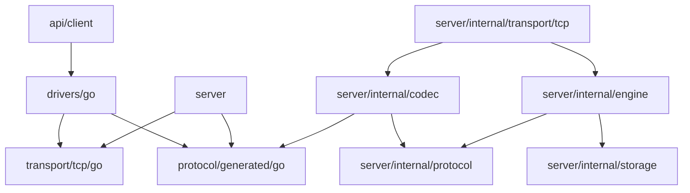

# Catálogo de Componentes

Este catálogo descreve os componentes presentes no código atual do MemoryDB. As classificações de camada indicam responsabilidades observadas, não pacotes formais de Clean Architecture.

O documento complementa a arquitetura geral do projeto, detalhando responsabilidades, dependências, contratos e comportamentos relevantes de cada componente.

As funcionalidades descritas como planejadas ou ausentes não devem ser interpretadas como implementadas.

## Componentes do servidor

| Nome | Camada | Tipo | Arquivo | Descrição | Depende de |
|---|---|---|---|---|---|
| `Request`, `Response`, comandos e resultados | Modelo interno | Modelo / contrato | `server/internal/protocol/message.go` | Representa solicitações e respostas sem depender de transporte ou Protobuf. | Biblioteca padrão Go |
| `Engine` | Aplicação / núcleo | Serviço de aplicação | `server/internal/engine/engine.go` | Valida e executa PING, SET, GET e DELETE. | `protocol`; implementação concreta `storage.Storage` |
| Códigos e resposta de erro | Aplicação / núcleo | Constantes / helper | `server/internal/engine/command.go` | Define `INVALID_REQUEST`, `INVALID_ARGUMENT`, `UNSUPPORTED_FEATURE` e helper de resposta. | `protocol` |
| `Storage` | Infraestrutura | Armazenamento em memória | `server/internal/storage/storage.go` | Mantém mapa chave-valor em memória, protegido por `sync.RWMutex`, copiando bytes na entrada e saída. | Biblioteca padrão `sync`; `Entry` |
| `Entry` | Modelo de armazenamento | Estrutura de dados | `server/internal/storage/entry.go` | Guarda os bytes de um valor. Não possui campo de TTL. | Biblioteca padrão Go |
| `Codec` | Port / contrato | Port | `server/internal/codec/codec.go` | Define operações de codificação e decodificação das mensagens internas. | `protocol` |
| `protobuf.Codec` | Adaptadores | Adapter | `server/internal/codec/protobuf/codec.go` | Converte entre o modelo interno e as mensagens Protobuf geradas. | `codec.Codec`, `protocol`, tipos gerados e runtime Protobuf |
| `Handler` | Transporte / aplicação | Dispatcher | `server/internal/transport/tcp/handler.go` | Processa requisições de uma conexão, chama o engine e devolve respostas. | `engine.Engine`, `codec.Codec`, módulo TCP |
| `Server` | Transporte / apresentação | Servidor TCP | `server/internal/transport/tcp/server.go` | Aceita conexões concorrentes e controla o shutdown. | `net.Listener`, `Handler`, `context`, `sync` |
| Executável do servidor | Composição | Entry point | `server/cmd/memorydb/main.go` | Configura dependências, endereço, sinais e ciclo de vida do servidor. | Codec Protobuf, engine e transporte TCP |

### Responsabilidades e contratos

**`Request` e `Response`**

Representam o contrato interno entre o handler, o codec e o engine.

- `Request` contém o identificador da solicitação e o comando.
- `Response` contém o identificador correspondente, o estado de sucesso e o resultado.
- Os comandos e resultados são independentes das mensagens Protobuf.
- O `RequestID` é preservado pelo engine na resposta.

Esses tipos não implementam persistência, identidade de domínio ou controle de ciclo de vida de operações.

**`Engine`**

Responsável pela execução das operações e pelas validações da aplicação.

Comportamentos implementados:

- Requisição nula, comando ausente ou desconhecido e comando tipado nulo resultam em `INVALID_REQUEST`.
- Chave vazia em SET, GET ou DELETE resulta em `INVALID_ARGUMENT`.
- SET com `TTLMillis > 0` resulta em `UNSUPPORTED_FEATURE`.
- SET com TTL igual a zero grava o valor sem expiração.
- GET diferencia chave inexistente de chave existente com valor vazio.
- DELETE informa se a chave foi removida.
- O identificador da solicitação é preservado na resposta.

O engine depende diretamente de `*storage.Storage`. Não existe atualmente uma interface de armazenamento que permita substituir a implementação concreta sem modificar essa dependência.

**`Storage` e `Entry`**

O storage mantém os dados em um mapa em memória.

- Chaves são strings.
- Valores são sequências de bytes.
- `sync.RWMutex` protege o acesso concorrente.
- SET copia os bytes recebidos.
- GET retorna uma cópia dos bytes armazenados.
- DELETE remove a entrada e informa se ela existia.

`Entry` representa o valor armazenado. Não possui metadados de expiração, persistência ou versão.

O storage não oferece durabilidade. O encerramento do processo implica perda dos dados.

**`Codec` e `protobuf.Codec`**

A interface `codec.Codec` define a conversão entre o modelo interno e a representação serializada.

Operações:

- `EncodeRequest`
- `DecodeRequest`
- `EncodeResponse`
- `DecodeResponse`

O adaptador Protobuf implementa esse contrato utilizando os tipos gerados do schema externo.

A interface permite que outro formato de serialização seja introduzido sem exigir que o modelo interno passe a depender diretamente dele.

**`Handler`**

Responsável por coordenar o processamento de uma conexão.

O fluxo de processamento é sequencial:

1. Lê um frame.
2. Decodifica a solicitação.
3. Executa o comando no engine.
4. Codifica a resposta.
5. Escreve o frame de resposta.
6. Continua aguardando a próxima solicitação.

Falhas de framing, decodificação, codificação ou escrita interrompem o processamento daquela conexão.

Uma falha de decodificação não produz uma resposta estruturada de aplicação.

**`Server`**

Responsável por aceitar conexões e delegar o processamento ao handler.

- Aceita conexões TCP.
- Inicia uma goroutine para cada conexão aceita.
- Mantém controle das conexões ativas.
- Fecha o listener durante o shutdown.
- Aguarda a conclusão das conexões ou o cancelamento do contexto.

O shutdown atual não fecha diretamente as conexões ativas quando o contexto expira. Uma conexão bloqueada pode, portanto, continuar impedindo a conclusão da operação de shutdown.

O erro retornado por `Handler.Handle` é descartado pela goroutine do servidor. Não há registro estruturado dessa falha nesse ponto.

**Executável do servidor**

O ponto de composição instancia os componentes concretos e inicia o servidor.

Responsabilidades:

- Obter o endereço de escuta de `MEMORYDB_ADDR`.
- Utilizar `:6380` como endereço padrão.
- Instanciar o codec Protobuf.
- Instanciar o engine.
- Criar o handler TCP.
- Criar e iniciar o servidor.
- Tratar sinais de encerramento.
- Solicitar shutdown gracioso com timeout de 10 segundos.

## Componentes compartilhados

| Nome | Camada | Tipo | Arquivo | Descrição | Depende de |
|---|---|---|---|---|---|
| `Connection` | Transporte | Abstração de conexão | `transport/tcp/go/connection.go` | Encapsula `net.Conn`, permitindo leitura e escrita simultâneas e serializando operações concorrentes do mesmo tipo com mutexes separados. | `net.Conn`, `sync` e framing |
| `ReadFrame` / `WriteFrame` | Transporte | Framing | `transport/tcp/go/framing.go` | Lê e escreve frames com prefixo de tamanho Big Endian, payload entre 1 byte e 1 MiB e tratamento de operações parciais. | `encoding/binary`, `io` |
| Schema Protobuf | Integração externa | Contrato de protocolo | `protocol/proto/memorydb/v1/memorydb.proto` | Define envelopes, comandos, resultados, `request_id`, bytes, TTL e erros. | Protocol Buffers |
| Código Go Protobuf gerado | Integração externa | Código gerado | `protocol/generated/go/memorydb/v1/memorydb.pb.go` | Contém os tipos Go gerados a partir do schema externo. | Schema Protobuf e runtime Protobuf |

### `Connection`

A abstração `Connection` encapsula uma conexão `net.Conn` e fornece operações de leitura, escrita e fechamento.

Características:

- Leitura e escrita podem ocorrer simultaneamente.
- Leituras concorrentes são serializadas por um mutex próprio.
- Escritas concorrentes são serializadas por outro mutex.
- `Close` fecha diretamente a conexão subjacente, interrompendo operações de I/O bloqueadas.
- A criação rejeita conexões nulas, inclusive interfaces que contenham ponteiros tipados como nil.
- Os métodos públicos validam receivers nulos.

O fechamento não precisa aguardar os mutexes de leitura e escrita. Essa característica permite interromper uma operação bloqueada sem aguardar que ela termine naturalmente.

### `ReadFrame` e `WriteFrame`

Implementam o enquadramento das mensagens transmitidas por TCP.

Formato:

- Prefixo de 4 bytes.
- Tamanho representado por `uint32`.
- Ordem de bytes Big Endian.
- Prefixo não incluído no tamanho do payload.
- Payload permitido entre 1 byte e 1 MiB.

Comportamentos:

- Leitura completa com `io.ReadFull`.
- Tratamento de fragmentação do cabeçalho e do payload.
- Escrita completa mesmo quando o writer realiza escritas parciais.
- Erro quando o writer não apresenta progresso.
- Validação de tamanhos inválidos.
- Validação de leitores e escritores nulos.
- Validação de contagens inválidas retornadas pelo writer.

O módulo TCP não conhece Protocol Buffers, o engine ou os componentes internos do servidor.

Arquivos principais:

- `transport/tcp/go/framing.go`
- `transport/tcp/go/connection.go`

### Schema Protobuf e tipos gerados

O arquivo `.proto` é a fonte do contrato externo.

O schema define:

- Envelope de requisição.
- Envelope de resposta.
- Identificador `request_id`.
- Comandos PING, SET, GET e DELETE.
- Resultados correspondentes.
- Campo `ttl_ms`.
- Estrutura de erro de aplicação.
- Seleção de comandos e resultados por `oneof`.

Os arquivos Go gerados não devem ser editados manualmente. Alterações no contrato devem começar pelo schema e seguir o processo de geração adotado pelo projeto.

## Driver Go e cliente de demonstração

| Nome | Camada | Tipo | Arquivo | Descrição | Depende de |
|---|---|---|---|---|---|
| `Client` | Integração / cliente | Driver | `drivers/go/client.go` | Expõe operações Go para comunicação com o servidor, controlando o estado e o ciclo de vida da conexão. | Transporte TCP, tipos Protobuf e biblioteca padrão |
| `ServerError` | Integração / cliente | Tipo de erro | `drivers/go/client.go` | Representa erros estruturados retornados pelo servidor. | Biblioteca padrão Go |
| `OperationOutcomeUnknownError` | Integração / cliente | Tipo de erro | `drivers/go/client.go` | Representa uma operação cuja execução não pode ser confirmada pelo cliente após uma falha de comunicação. | Biblioteca padrão Go |
| Testes do driver | Testes | Testes automatizados | `drivers/go/client_test.go` | Verifica operações, concorrência, contextos, erros, resultados indeterminados e desconexões. | Driver Go |
| Executável cliente | Apresentação / demonstração | Entry point | `api/client/main.go` | Demonstra o uso do driver Go. | `drivers/go` |

### `Client`

O `Client` é a interface de integração utilizada pelas aplicações Go para acessar o MemoryDB.

Responsabilidades:

- Estabelecer uma conexão TCP.
- Enviar e receber frames.
- Serializar e desserializar mensagens Protobuf.
- Correlacionar solicitações e respostas por `request_id`.
- Expor PING, SET, GET e DELETE.
- Converter erros estruturados do servidor em erros Go.
- Serializar operações concorrentes na mesma conexão.
- Controlar cancelamentos e deadlines.
- Gerenciar o ciclo de vida da conexão.
- Impedir a reutilização de clientes encerrados ou invalidados por falhas de comunicação.

A API disponibiliza:

- `Dial`
- `DialContext`
- `New`
- `Close`
- `Ping` e `PingContext`
- `Set` e `SetContext`
- `Get` e `GetContext`
- `Delete` e `DeleteContext`

`DialContext` utiliza o contexto para controlar o estabelecimento da conexão. Esse contexto não fica associado automaticamente às operações posteriores.

O cliente possui três estados internos:

| Estado | Significado |
|---|---|
| `open` | Conexão disponível para operações |
| `closed` | Cliente encerrado explicitamente por `Close` |
| `failed` | Conexão invalidada após falha de comunicação ou protocolo |

As operações são serializadas por meio de um mecanismo baseado em canal (`operationGate`), com capacidade para uma operação por vez.

Esse mecanismo é compatível com o protocolo atual, que trabalha com uma solicitação e sua resposta por vez em cada conexão.

O driver não implementa multiplexação de solicitações na mesma conexão.

### `ServerError`

Representa um erro estruturado recebido em uma resposta válida do servidor.

Sua finalidade é distinguir erros de aplicação de falhas de transporte ou protocolo.

Um erro de aplicação reconhecido não invalida automaticamente o cliente, permitindo que outras operações sejam realizadas na mesma conexão.

Essa distinção depende do contrato de que uma resposta estruturada de erro representa uma rejeição da operação pelo servidor, e não uma falha de comunicação que deixou sua execução indeterminada.

### `OperationOutcomeUnknownError`

Representa uma situação na qual o cliente não consegue determinar se uma operação foi executada pelo servidor.

A falha de comunicação pode ocorrer depois que a solicitação foi transmitida e processada, mas antes que uma resposta confiável seja recebida.

O tipo contém:

| Campo | Responsabilidade |
|---|---|
| `RequestID` | Identifica a solicitação cujo resultado não pôde ser confirmado |
| `Cause` | Preserva a causa subjacente da interrupção ou falha |

O tipo implementa:

- `Error() string`
- `Unwrap() error`

A implementação de `Unwrap()` permite preservar a inspeção da causa original por meio de `errors.Is` e `errors.As`.

#### Cenários que podem produzir resultado indeterminado

- Escrita parcial ou falha de escrita depois que parte da solicitação foi transmitida.
- Cancelamento do contexto durante uma operação de rede.
- Expiração do deadline durante a comunicação.
- Conexão interrompida depois do envio da solicitação.
- Resposta perdida ou incompleta.
- Resposta Protobuf inválida.
- Divergência entre o `request_id` enviado e o recebido.
- Tipo de resposta incompatível com a operação solicitada.
- Resposta que não permite confirmar a execução da operação.

#### Cancelamento antes e durante a operação

O driver diferencia o cancelamento durante a espera pelo acesso à conexão do cancelamento durante a comunicação.

| Momento do cancelamento | Resultado | Estado do cliente |
|---|---|---|
| Aguardando o `operationGate` | Erro de contexto direto; a operação não começou | `open` |
| Durante I/O | `OperationOutcomeUnknownError` com a causa do cancelamento ou deadline | `failed` |

O cancelamento durante a espera pelo mecanismo de serialização não exige invalidar a conexão, pois a operação ainda não começou.

Durante I/O, por outro lado, o cliente fecha a conexão para interromper a comunicação. Como não é possível garantir se o servidor executou a solicitação, o resultado é classificado como indeterminado.

A sincronização entre conclusão da operação e cancelamento considera as transições de estado da operação. A primeira transição válida entre conclusão e interrupção determina o resultado observado pelo cliente.

#### Limites do contrato atual

`OperationOutcomeUnknownError` não implementa idempotência nem recuperação do resultado.

O `request_id` atual é sequencial e local à conexão. Ele não é uma chave estável entre tentativas e não permite deduplicação de operações no servidor.

O driver também não realiza retry automático.

Portanto, a aplicação cliente não deve repetir cegamente uma operação que retornou `OperationOutcomeUnknownError`. Antes de tentar novamente, deve considerar se a operação pode ter sido aplicada e quais efeitos uma execução duplicada produziria.

Mesmo operações aparentemente idempotentes, como SET de um mesmo valor, não devem ser consideradas universalmente protegidas contra duplicidade sem um contrato explícito que defina as garantias e os efeitos observáveis.

Ainda não estão implementados:

- Identificador de operação estável entre tentativas.
- Deduplicação de solicitações no servidor.
- Armazenamento dos resultados das operações processadas.
- Recuperação de uma resposta anterior por identificador de operação.
- Política de retenção e expiração dos registros de deduplicação.
- Retry automático seguro.

Essas capacidades exigem evolução coordenada do protocolo, do servidor e do driver.

### Executável cliente

O executável `api/client` demonstra o consumo da API pública do driver Go.

Não acessa diretamente os componentes internos do servidor e não implementa um protocolo de comunicação alternativo.

Arquivo principal: `api/client/main.go`.

## Interfaces e APIs públicas relevantes

| Interface ou método | Assinatura / comportamento | Evidência |
|---|---|---|
| `codec.Codec` | `EncodeRequest(*protocol.Request) ([]byte, error)`; `DecodeRequest([]byte) (*protocol.Request, error)`; `EncodeResponse(*protocol.Response) ([]byte, error)`; `DecodeResponse([]byte) (*protocol.Response, error)` | `server/internal/codec/codec.go` |
| `Engine.Execute` | `Execute(*protocol.Request) *protocol.Response` | `server/internal/engine/engine.go` |
| `Storage.Set` | `Set(key string, value []byte)` | `server/internal/storage/storage.go` |
| `Storage.Get` | `Get(key string) ([]byte, bool)` | `server/internal/storage/storage.go` |
| `Storage.Delete` | `Delete(key string) bool` | `server/internal/storage/storage.go` |
| `Connection.ReadFrame` | Lê um frame completo da conexão TCP. | `transport/tcp/go/connection.go` |
| `Connection.WriteFrame` | Escreve um frame completo na conexão TCP. | `transport/tcp/go/connection.go` |
| `Connection.Close` | Fecha a conexão subjacente e interrompe I/O bloqueado. | `transport/tcp/go/connection.go` |
| `Handler.Handle` | `Handle(net.Conn) error` | `server/internal/transport/tcp/handler.go` |
| `Server.Serve` | `Serve() error` | `server/internal/transport/tcp/server.go` |
| `Server.Shutdown` | `Shutdown(context.Context) error` | `server/internal/transport/tcp/server.go` |
| `Dial` | Estabelece uma conexão TCP e cria um cliente. | `drivers/go/client.go` |
| `DialContext` | Estabelece uma conexão TCP utilizando contexto para controlar a conexão inicial. | `drivers/go/client.go` |
| `New` | Cria um cliente a partir de uma conexão `net.Conn` existente. | `drivers/go/client.go` |
| `Client.Ping` / `Client.PingContext` | Envia PING e valida a resposta correspondente, com ou sem contexto. | `drivers/go/client.go` |
| `Client.Set` / `Client.SetContext` | Envia SET com chave, valor e TTL, com ou sem contexto. | `drivers/go/client.go` |
| `Client.Get` / `Client.GetContext` | Consulta uma chave e retorna valor, existência e erro, com ou sem contexto. | `drivers/go/client.go` |
| `Client.Delete` / `Client.DeleteContext` | Envia DELETE e informa se a chave foi removida, com ou sem contexto. | `drivers/go/client.go` |
| `Client.Close` | Encerra a conexão do cliente e impede novas operações. | `drivers/go/client.go` |
| `ServerError` | Representa erro estruturado retornado pelo servidor. | `drivers/go/client.go` |
| `OperationOutcomeUnknownError` | Representa resultado não confirmado após falha de comunicação; preserva `RequestID` e `Cause`. | `drivers/go/client.go` |

Os métodos com contexto permitem controlar o início e a execução das operações.

Quando o cancelamento ocorre antes do início da operação, enquanto o cliente aguarda acesso à conexão, a operação é descartada sem invalidar o cliente.

Quando o cancelamento interrompe uma comunicação de rede em andamento, a conexão é encerrada e o cliente passa para o estado `failed`, pois o resultado da solicitação no servidor pode ser desconhecido.

O contexto utilizado em `DialContext` controla apenas o estabelecimento da conexão. Ele não fica associado automaticamente às operações posteriores.

## Organização dos módulos Go

| Módulo | Diretório | Responsabilidade |
|---|---|---|
| `github.com/pescador95/memorydb/server` | `server/` | Implementação e executável do servidor |
| `github.com/pescador95/memorydb/transport/tcp/go` | `transport/tcp/go/` | Transporte TCP reutilizável |
| `github.com/pescador95/memorydb/drivers/go` | `drivers/go/` | Biblioteca cliente Go |
| `github.com/pescador95/memorydb/protocol/generated/go` | `protocol/generated/go/` | Tipos Go gerados do Protobuf |
| `github.com/pescador95/memorydb/api` | `api/` | Executável de demonstração |

O workspace raiz (`go.work`) coordena os módulos locais durante o desenvolvimento. Cada módulo mantém seu próprio `go.mod` e suas dependências.

## Dependências e direção arquitetural

A direção atual das dependências pode ser resumida assim:



O módulo de transporte TCP não depende de Protobuf. O driver e o servidor utilizam os tipos gerados e o transporte como dependências separadas.

Dentro do servidor, `codec.Codec` é a única interface explícita que funciona como Port. O engine utiliza diretamente `*storage.Storage`; não existe atualmente uma interface `Storage`, `Repository` ou equivalente.

## Observações sobre os componentes

1. **Storage concreto:** o engine depende diretamente de `*storage.Storage`. A substituição do backend exige alteração no engine. A criação e a composição das dependências são responsabilidades do ponto de entrada da aplicação.
2. **Modelo interno independente:** os tipos internos não utilizam diretamente os tipos gerados Protobuf.
3. **Transporte independente:** framing e conexão TCP não conhecem o formato Protobuf.
4. **Driver desacoplado do servidor:** o driver Go depende dos módulos compartilhados, não dos pacotes internos do servidor.
5. **Execução sequencial no driver:** um mecanismo de exclusão mútua baseado em canal serializa as operações de requisição/resposta. Não há multiplexação de solicitações simultâneas na mesma conexão.
6. **Erros de conexão:** o `Server.Serve` descarta o erro retornado por `Handler.Handle`; essa falha não é registrada nesse ponto.
7. **Shutdown:** o servidor aguarda conexões ativas, mas não as fecha diretamente quando o contexto expira.
8. **TTL:** o contrato Protobuf possui `ttl_ms`, mas a funcionalidade de expiração não está implementada.
9. **Resultado indeterminado:** o driver distingue uma operação rejeitada pelo servidor de uma operação cuja execução não pode ser confirmada após falha de comunicação.
10. **Idempotência ausente:** o identificador `request_id` não é um identificador de operação estável e não existe deduplicação server-side.
11. **Ausência de retry automático:** o driver não repete operações automaticamente após falhas de comunicação.
12. **Durabilidade ausente:** o storage é exclusivamente em memória e não oferece recuperação após reinicialização do processo.

## Testes associados

Os testes estão distribuídos junto aos módulos e componentes.

| Área | Local dos testes | Cobertura observada |
|---|---|---|
| Framing TCP | `transport/tcp/go/framing_test.go` | Prefixo Big Endian, fragmentação, limites, truncamento, interfaces nulas e escritas parciais |
| Conexão TCP | `transport/tcp/go/connection_test.go` | Conexões nulas, receivers nulos, interrupção de I/O, leituras e escritas concorrentes e full-duplex |
| Driver Go | `drivers/go/client_test.go` | Operações, concorrência, contextos, erros, desconexões e resultados indeterminados |
| Codec Protobuf | `server/internal/codec/protobuf/codec_test.go` | Round-trip, conversões e mensagens inválidas |
| Engine | `server/internal/engine/engine_test.go` | Comandos, validações e erros |
| Storage | `server/internal/storage/storage_test.go` | Operações, cópia de bytes e concorrência |
| Handler | `server/internal/transport/tcp/handler_test.go` | Processamento sequencial de requisições |
| Server TCP | `server/internal/transport/tcp/server_test.go` | Aceitação de clientes, concorrência e shutdown |
| Integração | `server/internal/integration/server_test.go` | Comunicação entre driver e servidor |

### Testes específicos do driver para resultados indeterminados

A cobertura recente inclui cenários específicos para:

- Escrita parcial com retorno de `OperationOutcomeUnknownError`.
- SET executado pelo servidor seguido de perda da resposta.
- Cancelamento durante a leitura da resposta final.
- Preservação da causa original do erro.
- Transição coerente do cliente para `failed`.
- Comportamento do cliente quando o cancelamento ocorre antes do início da operação.

Os testes de cancelamento durante a conclusão da operação consideram a concorrência entre o callback de cancelamento e o término da operação. Dependendo da ordem em que essas transições acontecem, o resultado pode ser sucesso ou resultado indeterminado, desde que o estado do cliente permaneça coerente.

### Validação recente confirmada

Foram executados e aprovados no módulo `drivers/go`:

```bash
go test -v -count=1 ./drivers/go
go test -race -count=1 ./drivers/go
go test -race -count=20 ./drivers/go
go vet ./drivers/go
```

A execução repetida com o detector de condições de corrida passou nos testes do driver. O `go vet` terminou sem apontamentos.

Esses resultados representam a validação recente do módulo `drivers/go`. Não devem ser interpretados como uma nova execução consolidada de todos os módulos do workspace.

### Validação anterior do projeto

Também há registro de validações anteriores das demais áreas do projeto e de uma execução manual ponta a ponta em 15/11/2026, utilizando o servidor real e a aplicação `api/client`.

O fluxo manual validado foi:

1. Conexão TCP e PING.
2. SET de uma chave.
3. GET e conferência do valor.
4. DELETE da chave.
5. Novo GET, confirmando que a chave não foi encontrada.

Resultado: ciclo completo executado com sucesso.

## Limites e evoluções futuras

Os componentes atuais atendem ao escopo inicial do MemoryDB, mas ainda não fornecem garantias de durabilidade, recuperação distribuída ou execução idempotente.

Evoluções que exigem mudanças coordenadas entre componentes:

| Evolução | Componentes envolvidos | Objetivo |
|---|---|---|
| Contrato de idempotência | Schema Protobuf, modelo interno, engine, storage de operações e driver | Identificar operações de forma estável e evitar execução duplicada |
| Deduplicação | Handler, engine e armazenamento de resultados | Reconhecer solicitações repetidas e recuperar resultados anteriores |
| Timeouts no servidor | Server, Handler e configuração | Limitar operações de rede bloqueadas |
| Shutdown forçado | Server e Connection | Encerrar conexões que não terminam dentro do prazo |
| Observabilidade | Server, Handler e driver | Registrar erros, métricas e eventos operacionais |
| TTL | Schema, modelo interno, engine e storage | Implementar expiração de entradas |
| Persistência | Storage e componentes de recuperação | Preservar dados após reinicialização |
| Multiplexação | Protocolo, handler e driver | Permitir várias solicitações em andamento na mesma conexão |

A implementação de idempotência deve anteceder retries automáticos. Sem um identificador estável, deduplicação e recuperação de resultados, repetir uma operação após resultado indeterminado não oferece garantia de execução única.

## Diretrizes de documentação dos componentes

A documentação do projeto deve separar dois níveis de informação:

**Comentários no código:**

- Documentar identificadores exportados conforme as convenções GoDoc.
- Explicar contratos locais, parâmetros, retornos e erros.
- Registrar invariantes e decisões não óbvias necessárias para compreender a implementação.
- Evitar comentários redundantes que apenas repitam o nome ou a operação executada.

**Documentação Markdown:**

- Descrever responsabilidades completas dos componentes.
- Explicar fluxos entre módulos.
- Registrar garantias, limitações e cenários de falha.
- Documentar decisões arquiteturais e comportamentos que envolvem múltiplos componentes.
- Manter exemplos de utilização e contratos públicos.

A documentação externa complementa os comentários do código; não deve substituir os comentários essenciais da API pública.