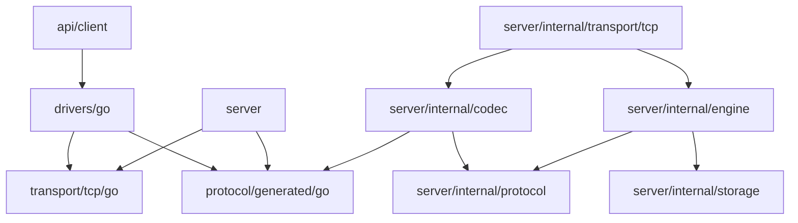

# Catálogo de Componentes

Este catálogo descreve os componentes presentes no código atual do MemoryDB. As classificações de camada indicam responsabilidades observadas, não pacotes formais de Clean Architecture.

## Componentes do servidor

| Nome | Camada | Tipo | Arquivo | Descrição | Depende de |
|---|---|---|---|---|---|
| `Request`, `Response`, comandos e resultados | Modelo interno | Modelo / contrato | `server/internal/protocol/message.go` | Representa solicitações e respostas sem depender de transporte ou Protobuf. | Biblioteca padrão Go |
| `Engine` | Aplicação / núcleo | Serviço de aplicação | `server/internal/engine/engine.go` | Valida e executa PING, SET, GET e DELETE. | `protocol`; implementação concreta `storage.Storage` |
| Códigos e resposta de erro | Aplicação / núcleo | Constantes / helper | `server/internal/engine/command.go` | Define `INVALID_REQUEST`, `INVALID_ARGUMENT`, `UNSUPPORTED_FEATURE` e helper de resposta. | `protocol` |
| `Storage` | Infraestrutura | Adaptador de armazenamento | `server/internal/storage/storage.go` | Mantém mapa chave-valor em memória, protegido por `sync.RWMutex`, copiando bytes na entrada e saída. | Biblioteca padrão `sync`; `Entry` |
| `Entry` | Modelo de armazenamento | Estrutura de dados | `server/internal/storage/entry.go` | Guarda os bytes de um valor. Não possui campo de TTL. | Biblioteca padrão Go |
| `Codec` | Port / contrato | Port | `server/internal/codec/codec.go` | Define operações de codificação e decodificação das mensagens internas. | `protocol` |
| `protobuf.Codec` | Adaptadores | Adapter | `server/internal/codec/protobuf/codec.go` | Converte entre o modelo interno e as mensagens Protobuf geradas. | `codec.Codec`, `protocol`, tipos gerados e runtime Protobuf |
| `Handler` | Transporte / aplicação | Dispatcher | `server/internal/transport/tcp/handler.go` | Processa requisições de uma conexão, chama o engine e devolve respostas. | `engine.Engine`, `codec.Codec`, módulo TCP |
| `Server` | Transporte / apresentação | Servidor TCP | `server/internal/transport/tcp/server.go` | Aceita conexões concorrentes e controla o shutdown. | `net.Listener`, `Handler`, `context`, `sync` |
| Executável do servidor | Composição | Entry point | `server/cmd/memorydb/main.go` | Configura dependências, endereço, sinais e ciclo de vida do servidor. | Codec Protobuf, engine e transporte TCP |

## Componentes compartilhados

| Nome | Camada | Tipo | Arquivo | Descrição | Depende de |
|---|---|---|---|---|---|
| `Connection` | Transporte | Abstração de conexão | `transport/tcp/go/connection.go` | Encapsula `net.Conn`, serializando leituras e escritas com mutexes separados. | `net.Conn`, `sync` e framing |
| `ReadFrame` / `WriteFrame` | Transporte | Framing | `transport/tcp/go/framing.go` | Lê e escreve frames com prefixo de tamanho Big Endian e máximo de 1 MiB. | `encoding/binary`, `io` |
| Schema Protobuf | Integração externa | Contrato de protocolo | `protocol/proto/memorydb/v1/memorydb.proto` | Define envelopes, comandos, resultados, `request_id`, bytes, TTL e erros. | Protocol Buffers |
| Código Go Protobuf gerado | Integração externa | Código gerado | `protocol/generated/go/memorydb/v1/memorydb.pb.go` | Contém os tipos Go gerados a partir do schema externo. | Schema Protobuf e runtime Protobuf |

## Driver Go e cliente de demonstração

| Nome | Camada | Tipo | Arquivo | Descrição | Depende de |
|---|---|---|---|---|---|
| `Client` | Integração / cliente | Driver | `drivers/go/client.go` | Expõe operações Go para comunicação com o servidor. | Transporte TCP, tipos Protobuf e biblioteca padrão |
| `ServerError` | Integração / cliente | Tipo de erro | `drivers/go/client.go` | Representa erros estruturados retornados pelo servidor. | Biblioteca padrão Go |
| Testes do driver | Testes | Testes automatizados | `drivers/go/client_test.go` | Verifica operações, concorrência, erros e desconexões. | Driver Go |
| Executável cliente | Apresentação / demonstração | Entry point | `api/client/main.go` | Demonstra o uso do driver Go. | `drivers/go` |

## Interfaces e contratos públicos relevantes

| Interface ou método | Assinatura / comportamento | Evidência |
|---|---|---|
| `codec.Codec` | `EncodeRequest(*protocol.Request) ([]byte, error)`; `DecodeRequest([]byte) (*protocol.Request, error)`; `EncodeResponse(*protocol.Response) ([]byte, error)`; `DecodeResponse([]byte) (*protocol.Response, error)` | `server/internal/codec/codec.go` |
| `Engine.Execute` | `Execute(*protocol.Request) *protocol.Response` | `server/internal/engine/engine.go` |
| `Storage.Set` | `Set(key string, value []byte)` | `server/internal/storage/storage.go` |
| `Storage.Get` | `Get(key string) ([]byte, bool)` | `server/internal/storage/storage.go` |
| `Storage.Delete` | `Delete(key string) bool` | `server/internal/storage/storage.go` |
| `Connection.ReadFrame` | Lê um frame completo da conexão TCP. | `transport/tcp/go/connection.go` |
| `Connection.WriteFrame` | Escreve um frame completo na conexão TCP. | `transport/tcp/go/connection.go` |
| `Handler.Handle` | `Handle(net.Conn) error` | `server/internal/transport/tcp/handler.go` |
| `Server.Serve` | `Serve() error` | `server/internal/transport/tcp/server.go` |
| `Server.Shutdown` | `Shutdown(context.Context) error` | `server/internal/transport/tcp/server.go` |
| `Client.Ping` | Envia PING e valida a resposta correspondente. | `drivers/go/client.go` |
| `Client.Set` | Envia SET com chave, valor e TTL. | `drivers/go/client.go` |
| `Client.Get` | Consulta uma chave e retorna valor, existência e erro. | `drivers/go/client.go` |
| `Client.Delete` | Envia DELETE e informa se a chave foi removida. | `drivers/go/client.go` |
| `Client.Close` | Encerra a conexão do cliente. | `drivers/go/client.go` |

## Organização dos módulos Go

| Módulo | Diretório | Responsabilidade |
|---|---|---|
| `github.com/pescador95/memorydb/server` | `server/` | Implementação e executável do servidor |
| `github.com/pescador95/memorydb/transport/tcp/go` | `transport/tcp/go/` | Transporte TCP reutilizável |
| `github.com/pescador95/memorydb/drivers/go` | `drivers/go/` | Biblioteca cliente Go |
| `github.com/pescador95/memorydb/protocol/generated/go` | `protocol/generated/go/` | Tipos Go gerados do Protobuf |
| `github.com/pescador95/memorydb/api` | `api/` | Executável de demonstração |

O workspace raiz (`go.work`) coordena os módulos locais durante o desenvolvimento. Cada módulo mantém seu próprio `go.mod` e suas dependências.

## Dependências e direção arquitetural

A direção atual das dependências pode ser resumida assim:

O módulo de transporte TCP não depende de Protobuf. O driver e o servidor utilizam os tipos gerados e o transporte como dependências separadas.

Dentro do servidor, `codec.Codec` é a única interface explícita que funciona como Port. O engine utiliza diretamente `*storage.Storage`; não existe atualmente uma interface `Storage`, `Repository` ou equivalente.

## Observações sobre os componentes

1. **Storage concreto:** o engine instancia e mantém diretamente `storage.Storage`. A substituição do backend exige alteração no engine.
2. **Modelo interno independente:** os tipos internos não utilizam diretamente os tipos gerados Protobuf.
3. **Transporte independente:** framing e conexão TCP não conhecem o formato Protobuf.
4. **Driver desacoplado do servidor:** o driver Go depende dos módulos compartilhados, não dos pacotes internos do servidor.
5. **Execução sequencial no driver:** um mutex serializa as operações de requisição/resposta. Não há multiplexação de solicitações simultâneas na mesma conexão.
6. **Erros de conexão:** o `Server.Serve` descarta o erro retornado por `Handler.Handle`; essa falha não é registrada nesse ponto.
7. **Shutdown:** o servidor aguarda conexões ativas, mas não as fecha diretamente quando o contexto expira.
8. **TTL:** o contrato Protobuf possui `ttl_ms`, mas a funcionalidade de expiração não está implementada.

## Testes associados

Os testes estão distribuídos junto aos módulos e componentes:

| Área | Local dos testes | Cobertura observada |
|---|---|---|
| Framing TCP | `transport/tcp/go/framing_test.go` | Prefixo Big Endian, fragmentação, limites, truncamento e escritas parciais |
| Driver Go | `drivers/go/client_test.go` | Operações, concorrência, erros e desconexões |
| Codec Protobuf | `server/internal/codec/protobuf/codec_test.go` | Round-trip, conversões e mensagens inválidas |
| Engine | `server/internal/engine/engine_test.go` | Comandos, validações e erros |
| Storage | `server/internal/storage/storage_test.go` | Operações, cópia de bytes e concorrência |
| Handler | `server/internal/transport/tcp/handler_test.go` | Processamento sequencial de requisições |
| Server TCP | `server/internal/transport/tcp/server_test.go` | Aceitação de clientes, concorrência e shutdown |
| Integração | `server/internal/integration/server_test.go` | Comunicação real entre driver e servidor |

Na validação consolidada mais recente, todos os módulos passaram por `go test -race -count=1 ./...` e `go vet ./...`.